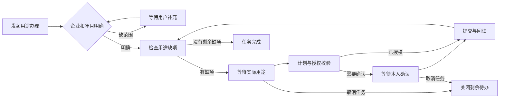

# 第三阶段 SPEC：多轮发票办理 v1.0

- 状态为开发与验收基准。首批主线与第二批恢复已通过本地程序模型验证，M-10 的真实模型验收待完成。
- 设计基线为 `main` 的 `40f45af`。当前功能工作区另有第二阶段文件生命周期改动，开始编码时以实际集成基线为准，并保留这些改动。
- 依据为《赛题二：财税+Agent+Harness+系统设计与实现复赛要求》第 1 页「多轮办理」。现场验收从原工作台操作，结合业务数据、操作日志、模型实际输入与答复判断。关联规范见[现有办理 SPEC](财税连续办理助手_SPEC.md)和[第一阶段 PRD](复赛第一阶段_PRD_Agent管理与能力复用_v1.0.md)。

## 1. 目标和开发范围

赛题考察助手在复杂财税对话中能否处理信息缺失、中途补充、局部更正和取消。项目已有任务、发票写入、权限与回执机制。本阶段用同一条发票任务验证这些机制能连续工作，按复现出的断点补实现。

首批范围是 2026 年 9 月的发票用途办理。用户在同一企业会话发起检查，补充缺少的月份，指定一张发票并提供真实用途，随后更正该发票，保留其他待办，最后取消剩余办理任务。首批同时验证用户确认、版本冲突、权限拒绝和取消与提交的竞争。

第二批在同一业务链路上增加跨会话续办、响应丢失、模型超时及服务重启。现有「每用户每企业一个未完成任务」继续适用。场景只修改发票用途，已有备注、发票金额、日期和规则保持原有语义。新的任务类型、通用工作流编辑和多任务并行编排另行排期。

## 2. 已有能力和待核实断点

| 环节 | 现有能力 | 首批开发与验收重点 |
|---|---|---|
| 对话和范围 | `request_evidence.py` 汇总本轮明确范围和可引用任务依据。 `runtime.py` 持久化待澄清轮次。 | 验证用途办理缺月份能追问一次，下一轮只给「2026 年 9 月」能继续原任务。排查范围补充被当成新目标、重复追问或串到其他企业的情况。 |
| 持久任务 | `tasks.py` 管理每用户／企业任务槽，保留版本、代次和检查证据。 | 使用已核验待办列表区分「某张票完成」与「整项任务完成」。校验一次保存或更正后其他待办完整保留。 |
| 发票修改 | `invoice_write.py` 和 `mutations.py` 已有计划、实际字段、版本、确认、数据库提交和回读。 | 检查任务派生的写计划能否从创建到提交都验证原任务仍有效，补齐取消后旧计划不能提交的边界。 |
| 保存后复查 | `tools.py` 和 `tasks.apply_result` 会核查票据检查结果、业务版本与任务版本。 | 保存后回读目标字段并刷新缺项。复查不成功时如实显示「已保存，待办待更新」。 |
| 页面与回执 | `App.tsx`、`Results.tsx` 和 `WritePlanCard.tsx` 已有对话、任务栏、确认卡、事项核对和办理记录。 | 在原入口分清「等待信息」「待确认」「已保存」「待办已取消」，能从消息打开对应证据。 |
| 已有程序覆盖 | `test_scope_clarification_recovery.py`、`test_runtime.py`、`test_memory.py` 分别覆盖范围澄清、检查、保存复查及任务变化。 | 新增连续办理和并发反例，用真实模型与浏览器完成完整主线。 |

## 3. 固定验收数据与主线

使用隔离比赛库。选择 U001、甲企业 C001 和拥有现有查询与写入权限的「财税办理助手」。默认样例的甲企业 2026 年 9 月用途缺项为 F002、F003、F004、F006、F009。首批精确验收可在测试夹具中为后三张填入模拟用途，使 F002 和 F003 成为唯一缺项，并记录两张票的初始用途、备注和 revision。夹具操作只用于隔离测试库。使用完整初始样例复验时，先核对五张缺项，并在办理 F002 后核对剩余四张。

| 轮次 | 验收输入 | 页面与数据库预期 |
|---|---|---|
| T1 发起 | 「帮我检查一下甲企业哪些发票还没填用途。」 | 已知甲企业，只问需要检查的年月。出现等待补充状态。发票字段与业务操作账本均无变化。 |
| T2 补月份 | 「2026 年 9 月。」 | 续办同一目标，在甲企业执行用途检查。展示两张缺项 F002、F003 和来源。任务等待提供实际用途。 |
| T3 只办理一张 | 「把甲企业 F002 的用途填写为办公耗材采购。F003 先别动。」 | 修改范围只有 F002 的用途。若现有授权策略要求确认，确认前字段不变，确认卡只列 F002。完成后回读 F002，显示唯一真实回执，并显示 F003 仍待补。 |
| T4 局部更正 | 「更正甲企业 F002 的用途为会议物料采购。F003 先别动。」 | 基于 F002 当前版本生成新计划和新回执。F002 显示更正后的用途，第一次回执保留。F003 及其 revision、两张票的备注不变，剩余待办为 F003。 |
| T5 取消 | 「取消这次甲企业 2026 年 9 月的用途补充任务。剩下的发票不办了。」 | 本任务取消，当前任务栏清除这条未完成任务。答复依据实际回执说明 F002 最终用途，以及 F003 未修改、对应待办已取消。账本没有回滚或新增发票写入。 |
| T6 核对 | 「这次保存了什么？还有没有待办？」 | 能核对先保存、后更正的记录和当前已取消任务。若另发一条明确的缺项检查，F003 仍是业务缺项，原取消任务不因旧对话复活。 |

主线 T3 和 T4 的确认按现有授权策略分支。若明确命令走直接授权，另用 M-05 的待确认案例覆盖确认前后的边界。

主线结束时，F002 的用途为「会议物料采购」，revision 相对开测增加 2，操作账本有两笔成功写入及可核对的回执。F003 的用途和 revision 与开测一致。任务状态为已取消，当前任务槽不再指向它。以测试前后的差异核对这些结论，避免把数据库已有操作计入本次结果。

## 4. 状态与交付口径

| 对象 | 事实来源 | 相关行为 |
|---|---|---|
| 对话轮次 | `turns.status`、`pending_clarification`、原始用户消息和轮次关联 | 发送追问时说明缺哪个字段，补充后关联原轮次。一次答复正常结束可以同时有未办项目。 |
| 办理任务 | `tasks`、`task_slots`、`task_revisions`、已核验检查结果 | 延用 `active`、`waiting_user`、`completed`、`cancelled` 等状态。保存子项后依据当前检查结果更新进度。任务取消后释放任务槽，保留真实记录。 |
| 发票写计划 | `write_plans`、授权来源、目标票号及 revision | 冻结企业、发票、字段和值。确认前显示「待确认」。取消、过期或目标版本变化后不能执行旧授权。 |
| 实际业务保存 | 发票当前字段、`operations` 提交状态、回读记录 | 只用真实提交和回读交付保存结果。旧回执记录当时状态，当前值从实际票据或新回执读取。 |

### 4.1 追问与续办

- 只追问当前执行必需且尚未证明的信息。企业已选定且用户未提出其他企业时，可按现有证据规则使用选定企业。用户明确指定的企业与当前企业不一致时，按现有权限和范围流程核对。
- 用户只补一个字段时，保留本任务已确定的其他字段。模型输入须包含可追溯的当前任务和待澄清范围，本轮解析使用真实补充内容。多个可能目标或与旧范围相冲突时，先澄清。
- 续办须通过当前用户、企业、任务代次和 Agent 权限校验。旧任务关闭、权限撤销或版本失效时阻止续办，并说明需要重新选择范围或发起新任务。
- 资料来源、助手旧回复或之前给过的用途可以帮助理解语境。写入仍要求本轮明确目标与新值，或者经过现有本人确认流程。

### 4.2 局部办理与更正

- 用户说「只办 F002」「F003 先别动」时，计划和实际写入须限定到明确授权的票号、字段和值。即使其他票同属待办或票面相似，也不能从其内容推定用途。
- 若输入只说「第一张」且存在唯一、仍有效的当前清单，可用现有选择引用。清单过期、排序变化或候选不唯一时重新检查并请用户确认。禁止旧序号指向另一发票。
- 更正同一张已保存票前读取当前字段及 revision，冻结新的计划和授权。旧回执记录第一次已完成修改，本轮回执记录更正。写入关键路径复用现有版本比较与幂等。
- 用当前企业、月份、业务数据 revision、规则 epoch 均相符的检查证据更新待办。只处理部分票时，剩余业务缺项继续保留在原任务。检查失败时明确待办需刷新，不能将上次数字作为更新结果。

### 4.3 任务取消与写计划

- 页面「停止生成」、确认卡「取消本笔计划」及用户「取消这次用途补充任务」是三个不同动作。任务取消关闭当前办理及关联的未提交计划，单笔计划取消保留任务的其他待办，停止本轮执行使用原有轮次取消机制。
- 对使用任务或待办证据定位、授权或续办所产生的计划，由服务端记录任务关联。关联至少能确定 `task_id`、`generation` 及原企业与月份。实现前先查是否已有等价可验证引用。如需持久化，新增兼容旧计划的可空字段或同等关系，保留原有独立确认路径。关联不能由模型省略以绕过检查。
- 确认请求和实际提交事务都核验当前任务关联、发票版本、授权来源、当前用户／企业权限及 Agent 工具权限。任务范围变化导致旧计划失效。仅其他票据的待办进度变化时，仍按原计划的票据及规则版本规则独立核对。取消只关闭绑定到同一任务代次的未消费计划，已消费计划及回执保留。
- 取消与保存用现有事务保护协调。锁序沿用执行权限锁、用户、企业，再锁定涉及的任务和计划记录。以数据库提交顺序裁决。**取消先提交**时，未消费计划不得写入。**写入先提交**时，保留唯一操作和回执，随后只关闭未办部分。已经排队的确认仍需实际提交前检查。
- 取消回复至少分清「已经保存」和「仍未提交且已取消」。若已保存但后置检查或答复生成失败，也返回真实保存状态并显示后续待核对。取消之后的明确新任务可按当前数据发起，旧任务和旧授权保持关闭。

## 5. 工程实施与接口约束

1. **先复现主线。** 基于隔离库和原入口分别运行程序模型与真实模型，记录每轮 `turn_id`、任务 revision、工具调用、发票字段和操作账本。从第一个报错或结果不一致处修复。原路径通过时保留实现。
2. **完善任务证据和回执展示。** 依次核对 `request_evidence.py`、`tasks.py`、`tools.py` 和 `answer_renderer.py`。若现有响应缺少区分来源和待办的数据，在已有任务或结果卡中补实际已核验字段。使用现有复查结果和可验证时效的证据，避免保存第二份平行待办清单。
3. **核查计划绑定和取消后的校验。** 复用 `prepare_invoice_write`、`update_invoice`、确认和取消 API。测试能证明缺失后再改 `invoice_write.py`、`mutations.py` 和任务取消路径。不同任务代次或企业的旧计划不能误关联到新任务。
4. **补原入口反馈与回归。** 复用任务栏、确认卡和「办理记录」。页面可读到企业／期间、目标票、当前状态、真实回执和剩余待办。旧记录、用户身份和已发布 Agent 版本继续兼容。按需补前端字段和最少的状态提示。

结果应保留可追踪的标识。范围用企业与期间，任务用 `task_id/generation/revision`，发票用企业、票号与 revision，计划与回执用已有 `plan_id`、`operation_id`。只有服务端验证后的实际结果用于渲染业务事实。无访问权限时，面向用户提示权限或范围问题，避免暴露无权票据及状态。

## 6. 首批验收矩阵

| 编号 | 用例 | 通过条件 |
|---|---|---|
| M-01 | 已知甲企业，缺月份。另测企业与月份同时缺失。 | 追问与实际缺失字段一一对应。未补齐前无写计划和业务写入。 |
| M-02 | 只回复月份，另测无关回答和冲突范围。 | 正确补充续办原任务。无关文本不闭合澄清，冲突能明确核对。 |
| M-03 | T3 只处理 F002。另测 F002 值没给出、F003 先不办。 | 仅在明确用途后按授权写 F002。F003 字段和 revision 不变，仍待补。 |
| M-04 | T4 更正 F002，另测旧清单或旧 invoice revision。 | 基于当前值的新更正按授权提交一次。过期目标或版本不能提交。其余待办保留。 |
| M-05 | 让现有策略生成待确认计划，在确认前查数据，再确认并重放。 | 确认前用途及写入账本无变化。确认后只产生一次提交。重放可核对到同一轮次或原回执。 |
| M-06 | T5 取消当前任务，再点击仍显示的旧确认卡。 | 任务槽释放，未提交计划失效，已保存值和回执保留。关联的旧计划不能提交。 |
| M-07 | 分别控制取消先提交、写入先提交两种顺序。 | 在 PostgreSQL 隔离库核对实际操作数和状态。第一种零写入，第二种只保留一笔真实写入，显示剩余项目取消。 |
| M-08 | 写入提交并回读后，让待办刷新失败。 | 已保存回执仍交付，待办显示需复查，重试无重复写入。 |
| M-09 | U002、只读 Agent、错误企业和换代任务分别尝试继续或确认。 | 仅执行本人、企业及 Agent 权限共同允许的操作。无跨范围写入或资料泄露。 |
| M-10 | 完成 T1–T6 的真实模型浏览器主线。 | 对话、任务栏、确认卡及办理记录与底层票据、待办、回执一致。保留真实调用轨迹。 |

M-01 至 M-09 用隔离程序测试断言数据库与权限结果。M-10 使用真实模型和模拟财税数据，按原工作台操作。额外回归原月度查询、原用途检查、原确认计划、Agent 停用与撤权，以及第二阶段 Excel 上传和查询。验收记录包含 commit、测试身份、企业和期间、用户原话、轮次及任务 ID、票据前后值与 revision、计划状态、操作记录和页面截图。

首批完成需同时满足 M-01 至 M-10，且既有链路回归通过。程序模型、真实模型与人工现场证据分别记录。

## 7. 第二批：换会话、超时与响应丢失

复用第一批的样例与断言，并覆盖以下场景。

| 编号 | 场景 | 通过条件 |
|---|---|---|
| R-01 | 保存 F002 后在同用户同企业的新会话说「继续上次用途补充」。 | 恢复同一有效任务。重新核对当前缺项，F003 待办仍在，F002 保持已保存。 |
| R-02 | 发起查询或确认后丢弃客户端响应，用同一请求编号重试。 | 找回原轮次或回执，业务提交不重复。状态未知时先核对原请求。 |
| R-03 | 模型超时，分别发生在提交前和已提交后的答复环节。 | 前者未保存且原待办可处理，后者如实交付保存回执并标出未完成部分。 |
| R-04 | 在待确认、已保存但待办需复查两种阶段重启服务。 | 从持久状态恢复，待确认仍需有效授权。已保存回执不重复写入，旧结论经复查才进入后续任务状态。 |
| R-05 | 切换企业、用户或 Agent 后尝试继续，与同身份权限恢复样例对照。 | 当前范围不匹配时提出必要澄清或明确拒绝。切回有权范围并通过当前校验后才能继续相应任务。 |

第二批使用真实服务进程与独立数据库做故障注入。记录故障发生点、原请求编号、重试结果及最终账本。首批真实模型验收的证据单独记录。

### 第二批验证记录

本地服务使用隔离模拟数据和程序模型。浏览器在查询请求和确认请求已被服务端受理后分别丢弃响应，从页面核对原请求，核验重试的请求编号、返回轮次及操作账本。

首次重启前保留待确认计划，重启后核对零写入并执行本人确认。确认提交后注入待办复查失败，再次重启后读取同一回执并重放确认。原用户在甲企业的新会话续办同一任务，复查后只剩 F003。乙企业会话的隐式续办、另一用户访问旧确认卡和只读 Agent 的写计划调用均被拦截。

独立服务进程分别在提交前与提交后的答复阶段注入模型超时，核对零写入和单笔已提交回执两种结果。重试已提交轮次后，操作编号及发票版本与首次提交一致。

程序测试入口为 `backend/tests/test_purpose_task_recovery.py`。浏览器入口为 `frontend/tests/purpose-task-live.spec.ts`，在独立模拟库上启用 `PURPOSE_TASK_E2E=1` 和 `PURPOSE_TASK_RECOVERY_E2E=1` 执行丢响应场景。
