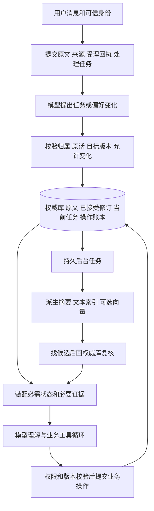

# 财税助手记忆与上下文融合机制

| 项目 | 内容 |
|---|---|
| 版本 | v1.0 |
| 日期 | 2026 年 10 月 25 日 |
| 状态 | 设计评审稿，尚未实现或经过故障验证 |
| 产品依据 | 财税连续办理助手 PRD v1.0、比赛材料 v1.1.0、用户新增的关键状态不丢失要求 |
| 设计目标 | 跨会话和压缩后关键状态可恢复，更正/删除不被旧结果覆盖，所有保证可以测试 |
| 实现形态建议 | 在现有 Python/PostgreSQL 路线上建设统一模块，使用一个权威数据库和可重建派生数据 |

## 1 必须先说清的不丢失

本机制承诺的对象是：已受理原文、已确认提交的有效偏好、任务状态和业务修改结果。保证建立在明确的提交协议、存储与恢复条件上，通过验收后才能宣布满足。当前没有实现，不能把本文当成已经获得零丢失能力。

| 保证 | 可验收定义 | 范围 |
|---|---|---|
| G1 已受理原文可查 | 服务端返回受理成功后，消息及来源记录已持久提交；应用进程退出后可查，重试不重复创建 | 存储介质完好、数据库采用可靠持久化配置、恢复未回退至旧备份 |
| G2 已确认状态可恢复 | 返回记忆保存/更正/删除成功或任务更新成功后，重开会话和进程恢复仍读取同一有效版本 | 以已提交修订和操作记录为准，不依赖进程内队列或模型摘要 |
| G3 压缩不删关键状态 | 压缩前后当前企业、月份、任务、未解决信息及有效关键偏好等必需状态相同，摘要不成为其唯一副本 | 程序预检约束；必需内容放不下时阻止静默裁剪 |
| G4 旧状态不复活 | 更正/删除后，旧摘要、索引、迟到后台结果和普通历史召回均不得恢复旧有效值 | 版本校验、删除代次、依赖失效和恢复检查共同约束 |
| G5 任务与业务结果一致 | 保存一次只发生一次有效业务修改；任务更新关联真实提交，续办按当前数据重查 | 本题业务数据、操作账本与任务写入位于同一数据库事务；多项操作逐项核对 |
| G6 归属不混用 | 原文、记忆、任务、输入及按 ID 的读改删均符合可信用户企业范围 | 应用检查覆盖精确读取和检索两条路径，命名空间不由模型自由指定 |

存储无丢失不等于任意自然语言都被完整理解，也不等于任何历史问题都能被语义检索命中。模型抽取和摘要可能遗漏语义；原文持续保留，未处理事项可见，关键状态独立保存，不能用第二个模型评审来声称语义零遗漏。

物理磁盘全部损坏时，单机数据库无法凭逻辑机制保证最新数据仍存在。首版故障保证覆盖应用崩溃、重试、并发、压缩和索引故障；备份恢复只保证恢复点包含的记录。如要连主存储损坏也保证已确认数据零丢失，需要独立故障域的同步副本等部署保障并另行验收，不能把定期备份称为零数据损失。

用户明确删除是一种授权状态变化，不能以“不丢失”为由继续作为有效记忆使用。删除偏好与删除原始个人数据是不同操作，见第 8 节。

## 2 选择这套机制的原因

| 备选路线 | 对本题的适配问题 | 本文选择 |
|---|---|---|
| 同时安装多个记忆后端 | 多套权威、更新和删除语义相互不一致，任务与业务状态难原子提交 | 统一模块借机制，不并列维护多套当前真值 |
| 以持续摘要作为全部记忆 | 摘要是有损表达，无法独立承担精确月份、操作结果和删除状态 | 摘要作为可重建导航，关键状态结构化保存 |
| 权威状态独立保存，摘要和索引用于定位与输入组织 | 能用数据库和程序检查保证关键状态，并保留模型灵活理解 | 采用，按下文实现与验收 |

优点之间存在取舍。后台抽取可以降低交互延迟，却不能单独承担“立即记住”的确认；热度淘汰可以节省空间，却不能自动删除仍有效的任务或明确偏好。本设计优先兑现本题的明确偏好、持续办理、正确规则和真实保存。

## 3 六类项目的机制如何落到本题

| 参考 | 借入机制 | 本题适配 | 有意不照搬的默认行为 |
|---|---|---|---|
| DeerFlow | 写入范围/持久性/性质校验、压缩前捕获、后台生命周期 | 用户企业范围、明确原话验证；关键状态先同步保存 | 自动画像推断、一切记忆都等后台抽取 |
| LangGraph | 会话检查点与跨会话 Store 分离 | 会话按 thread 管理；任务按用户企业读取 | 把换 thread 等同于任务丢失或创建另一份任务 |
| Letta | 少量核心上下文常驻，深层证据按需读取 | 关键任务字段保留固定输入位置，历史证据有预算 | 让模型自由改写任务唯一真值 |
| Mem0 | 记忆条目、变更历史、去重、可解释检索 | 稳定偏好键、版本链和来源；显式更正当前值 | 认为追加式抽取自动解决旧值失效；只用向量候选找编号 |
| OpenViking | 概览/原文分层读取、来源可定位 | 摘要带来源清单；重要规则需要完整原文 | 把摘要当完整证据，或初版引入庞大的外部上下文系统 |
| Graphiti | 来源关联、时间有效性、删除对派生内容的影响 | 用关系表表示来源与版本、业务生效时间和系统记录时间 | 为少量结构化任务引入完整图数据库和概率式规则冲突判断 |
| 现有 RSI 原型 | 来源 revision、修订/停用、执行身份与迟到提交校验 | 保留并扩展用户企业隔离、操作账本和删除代次 | 沿用 OWNER=local 或依靠单一关键词召回覆盖全部任务 |

这些是适配建议，不声称项目默认机制已经满足下文全部保证。源码与版本边界见[开源记忆机制调研](./开源记忆机制调研与升级建议.md)。

## 4 总体结构与权威归属

数据库是逻辑唯一权威，不代表只保留一个物理副本。模型可提出状态变化，程序验证后才能成为权威。原文、已接受修订、任务与业务数据各有职责；只有被授权删除的数据例外，普通压缩和清索引不触碰它们。

| 数据类别 | 内容 | 原则 |
|---|---|---|
| 原文与来源 | 接收消息、实际工具结果、来源 ID/revision、顺序和内容 hash | 提交后可查；hash 用于校验，恢复还需要真实副本，hash 本身不能修复内容 |
| 有效偏好及修订 | 稳定键、当前版本、作用范围、明确原话、来源、有效/删除状态 | 更正保留版本链，当前值唯一；旧值只在有权的历史管理视图展示 |
| 任务及修订 | 用户、企业、月份、意图、待补项、状态、操作关联、检查时数据版本 | 每用户每企业最多一项未完成任务，跨会话精确读 |
| 业务数据与操作账本 | 当前发票、流水、操作 ID、真实提交结果、数据 revision | 查询与修改以此为准；修改次数和任务进度可核对 |
| 规则及版本 | 企业范围、生效日期、启停状态、原文与执行条件 | 有自己的维护权限；偏好和模型总结不能更改规则 |
| 派生数据 | 摘要、词法/向量索引、召回缓存 | 可删除重建，永远不能单独宣布当前事实或写入授权 |
| 处理记录 | 原文处理状态、后台工作项、失败/重试、上下文清单 | 每个已受理来源可追踪；失败不伪装成无变化或无记忆 |

## 5 提交协议与持久化

### 5.1 三类回执必须区分

| 回执 | 返回前的条件 |
|---|---|
| 已收到 | 原文、来源、请求去重身份和处理任务已在同一数据库事务持久提交 |
| 已记住/已更正/已删除 | 对应偏好或任务状态变更及版本记录已持久提交；不只是排入内存队列 |
| 发票已保存并核验 | 业务提交已确认，随后读取结果与目标一致；若核验未完成则单独说明 |

客户端请求 ID 与请求内容指纹唯一绑定。同 ID 同内容返回已有结果，同 ID 换内容报冲突；请求重试不生成新消息或重复业务操作。回包丢失时按原身份查状态，不能简单重新调用有副作用工具。

### 5.2 事务与后台工作

原文、来源与待处理工作项同事务提交，采用数据库持久 outbox/工作表即可，不需要先引入消息队列。后台采用至少一次领取，依靠 `(来源 ID, 来源 revision, 处理用途, 处理版本)` 等唯一身份去重；不宣称外部模型调用恰好一次。

每项工作有待处理、处理中、完成、失败待处理、因版本失效废弃等状态。领取带租约/执行代次，迟到 worker 失去提交权。模型调用超时不盲目假定没调用过；账本保存真实已知结果与未知状态。

后台完成状态与本次接受的派生结果在同一事务提交，进程在两者之间退出也不能产生看似完成却无结果的状态。失败工作不永久卡住其他独立来源，但连续处理水位不能跨过未解决缺口；另存已完成清单和缺口记录。

### 5.3 数据库耐久性与恢复要求

关键数据使用普通持久表和可恢复存储，不能放在临时/UNLOGGED 表或仅驻留进程内存。启用并核验 PostgreSQL 的 fsync、full_page_writes、关键事务 synchronous_commit；实际持久性仍依赖存储正确履行刷新语义。不同数据库版本的默认值不能代替部署检查。[PostgreSQL WAL 配置](https://www.postgresql.org/docs/current/runtime-config-wal.html)、[可靠性说明](https://www.postgresql.org/docs/current/wal-reliability.html)

应用启动恢复未完成工作并核对执行身份；不能通过启动重导原 Excel 覆盖当前数据，不能把已完成业务事件当新用户指令重放。

备份包括权威数据、规则、当前指针、已接受修订、删除状态和恢复水位，并记录一致恢复点。单纯数据库 dump 只覆盖备份时刻；需要恢复到更晚点时另有可用 WAL/日志或副本。发布可靠性声明前，在独立环境完成恢复核验。[PostgreSQL 备份与恢复](https://www.postgresql.org/docs/current/backup.html)

## 6 写入判断与来源约束

模型可以提出任务字段变化、明确偏好增改或待澄清事项。程序检查：可信用户企业范围、真实来源和 revision、用户原话位置、来源受理序号、允许字段、稳定键、目标期望版本、删除代次及执行身份。

有效偏好和任务字段保存本次接受变化的来源顺序标记。旧来源即使在较晚时间才开始抽取、读取到了最新目标版本，也不能因此变成新指令覆盖当前值；来源顺序落后于该字段已接受更正或删除的提案拒绝修改当前头，只能在允许范围作为历史证据。业务生效时间与系统记录/处理时间分别保存，不用后台完成时间决定用户指令的新旧。

偏好采用“当前用户明确表达 → 提案 → 验证 → 提交 → 确认”路径。用户没有明确表达的推断不自动生效；助手建议只能是派生文本。任务完成由业务结果决定，不能由助手口头声明决定。

不能通过关键词路由替代模型理解。若模型未完整识别一条自然语言中的偏好，原文仍然可查，但系统不能把“来源已处理”的技术记录等价成“全部语义已正确提取”。对此需要明确表达/更正用例、来源引用校验与真实模型评测；存在歧义时追问，保存失败则说明未保存。

不做依访问次数自动淘汰仍有效的明确偏好，不因 top-k 或容量竞争静默丢掉当前任务。容量确有不足时停止接受该变化或明确要求缩小范围，保留原状态与原文，不谎报已记住。

## 7 任务与业务操作如何保持一致

本题的发票更新、操作账本、相关任务版本变化在同一个 PostgreSQL 事务中完成。按企业和发票联合定位，验证当前权限、允许字段、目标 revision 和有效规则；提交成功后读取当前数据确认，再形成回复。

任务记录可以保存上次检查的缺项引用和检查时间，但该清单是带数据版本的快照。另一个用户补过发票或规则变化后，恢复时重新检查；不能用旧快照宣布最新剩余事项。查询结果带明确查询范围、时间与数据 revision，不声称未来也保持相同。

任务替换有独立代次。旧任务的后台结果或旧会话不能更新已被替换的当前任务。新会话只恢复范围和意图，不从记忆中重新获得修改授权。

已提交但回包丢失：按原操作 ID 查账本和当前记录；已知成功则返回已有结果，已知未执行才允许同身份继续，未知时不生成另一个写操作。多发票请求逐项记真实状态，不把部分成功写成全部完成。

## 8 更正、删除与防止旧值复活

### 8.1 更正

同一偏好稳定键只指向一个有效版本。在一个事务中写入新修订、更新当前指针、使旧值退出当前读取，并登记依赖失效工作。使用期望版本防止两个写入静默覆盖；冲突后重新读取并判断，不任意采用后返回的模型结果。重新读取最新版本也不能绕过原始来源顺序约束。

### 8.2 删除与重新记住

“删除偏好”写入删除状态及代次，立即影响读取。旧向量尚未清理、旧摘要还在、旧提取仍执行，都要在最终来源/当前头版本检查时被拒绝。删除不依赖后台成功清索引后才生效。

用户以后明确要求重新记住同一偏好，可以创建新代次；新来源必须晚于该删除并有明确重新建立的指令，不能让旧后台工作自动创建。更正、删除和任务替换均以当前权威版本校验，缓存不决定提交资格。

删除偏好表示不再作为有效记忆自动使用。若用户要求删除原始个人内容，需按独立的原文删除语义清理正文及派生资料，并按备份保留/恢复政策处理；不能一边永久保留可召回正文，一边声称已彻底擦除原始数据。业务审计和普通可召回记忆分别管理。

恢复旧备份前，必须确认恢复点包含所需最新更正/删除记录，或能补齐之后的日志。恢复不充分时保持恢复检查状态，不开放旧记忆给模型；不能为恢复完整性而让已删内容重新生效。

## 9 召回分两条路径

### 9.1 必需状态的精确读取

可信身份、当前企业/月、有效未完成任务、任务未解决信息、适用范围的有效明确偏好、当前操作结果及必要规则，使用稳定 ID/键和明确范围读取。关键条目不依赖语义排名命中。

当前企业和月份由可信选择、本轮明确指令或已确认任务给出。范围有歧义时追问；不为凑齐输入而默认取相似企业或最近月份。用户跨企业查询时每组结果与其企业范围分别标明。

### 9.2 历史证据的可选检索

已授权和有效来源内进行编号/日期/文本精确匹配；必要时评估向量与重排补语义匹配。纯关键词分支和语义分支各自产生候选，保留精确编号命中；去重与排名不改变来源归属。

所有候选再次回权威库读取原文并检查 revision、删除和当前值；索引文本或摘要不能跳过校验直接注入。查不到是正常空结果，存储/权限/索引故障分别记录，不相互伪装。

历史检索失败时，可靠读取的当前任务仍可支持相应处理；某项必需状态读失败则暂停依赖它的动作，不用空列表继续。需要过去某个具体细节却无可靠证据时，精确定位来源或追问，不能强行补全。

## 10 每轮输入装配与完整性清单

上下文模块接收必需状态与可选证据，输出模型请求和同一份输入清单。清单记录本轮身份/作用范围、任务/偏好/规则版本、操作结果引用、原文 span、来源 hash/revision、压缩代次和实际装配情况。

初赛有效偏好数量有限时，在适用范围内完整加载，避免让语义选择决定关键偏好是否存在。预算不足时依次去掉可选历史、读取更小但完整的证据、保留完整近期消息组；必需状态仍放不下则明确暂停或缩小任务，不能静默漏字段。

发送前检查：

1. 本轮当前输入完整，没有被截断或遗漏。
2. 企业、年月、任务代次、未解决信息等已知必需字段实际在输入中；字段缺失与用户尚未提供信息要区分。
3. 没有被更正/删除或超范围的证据；必要规则保留完整条件和例外。
4. 工具调用与结果成组配对，未完成操作和结果未知状态不被摘要成成功。
5. 来源与关键头版本仍有效；读取期间发生更正/删除则重建输入或停止，不用陈旧快照提交。
6. 请求整体预算包含系统内容、工具定义、消息和输出预留。用实际所选模型可用的 tokenizer/计数能力校验；只有估算时明确标注估算，不能把 UTF-8 字节数叫实际 token 数。

清单可以证明某字段被提供给模型，不能证明模型一定正确使用。高风险业务判断仍由工具校验，模型回答正确性另行评估。

删除或更正在请求发出后发生，已经发给模型的旧输入无法追溯撤回；在途正式答复与写操作提交前还需复核版本，失效结果不能发布为新的正式答复或执行修改。首版建议这类答复在校验后一次性显示，处理期间只展示真实进度，不提前展示可能需要撤回的成功声明。过去已经展示的历史记录与新的有效记忆分别管理。

## 11 压缩采用先保存、再构建、校验后切换

1. **保存**：原文已持久化；确认任务和明确偏好变更已处理或显式标为待处理。被压缩区间的来源处理清单完整，没有未记账缺口。
2. **冻结快照**：记录来源 ID/revision、消息区间、任务/偏好头版本、关键状态校验值。只压缩闭合的旧消息组，保留当前输入和未闭合工具组。
3. **生成派生摘要**：摘要带原文引用，不能改写权威任务。当前主体、日期、否定、更正、未解决事项和实际操作状态优先保留；失败时不改变原视图。
4. **校验**：核对来源集合和版本、必需状态不变量、工具配对和请求预算。程序字段检查不能被一个模型“检查通过”替代。
5. **条件切换**：只有快照仍有效才发布新摘要和上下文视图；生成期间发生删除/更正则废弃旧候选或重做，不能先删旧视图再等摘要返回。
6. **回退和再读取**：摘要有歧义时读取原文。原始消息仍在库中；空间预算不足导致本轮无法继续时明确报告，不以不完整摘要悄悄完成业务。

为每个来源记录待处理、已评估无变化、已接受变化或明确失败等状态，防止压缩跳过从未处理的输入。这证明处理覆盖，不证明任意自然语言全部语义已被理解；后一项由测试和澄清交互约束。

## 12 一条适配本题的完整过程

用户 U001 发起甲企业 2026 年 9 月用途检查。原文先提交；模型识别任务，程序记录企业/月和任务代次，检查工具按 R002 2.0 得到当前缺项，并保存带数据版本的检查记录。

用户明确补充 F002 用途。工具在一项事务中修改该企业的 F002、登记操作、更新对应任务版本；提交后重查。用户看到真实保存结果及当前剩余事项。

用户要求以后先显示汇总，后又改成先显示待办。两次明确原话分别形成版本，只有新值有效。长对话压缩时任务和新偏好保持独立，摘要只帮助定位过去交流。

后台旧抽取还在返回时，用户删除该偏好。删除代次使旧返回失去提交资格，旧向量命中也无法通过读取校验。新会话恢复甲企业任务，重新查询当前缺项；用户切换乙企业时使用乙企业任务和规则，不套用甲企业清单。

以上每个阶段都可以强制退出应用或注入失败，在相应提交范围内检查恢复；没有提交确认的变化不得被说成已可靠保存。

## 13 交付和硬验收门槛

机制分四个实现阶段：先做原文/修订/操作账本和真实持久提交，再做任务与偏好的版本生命周期，再做必需输入装配和压缩，最后做派生检索与恢复演练。首版在同一数据库内完成关键事务，不建立六套后端。

硬性正确性验收：测试范围内已确认记录丢失为零、旧值复活为零、跨用户企业误用为零、重复有效业务修改为零、已知必需字段静默丢弃为零。任何一项失败都阻断该机制的可靠性验收，不能由平均问答分数抵消。

语义理解、自由问答、同义召回和输入节约单独报告效果，不能承诺所有问题 100% 命中。准确率、成本和延迟必须在相同模型、数据和预算下对照测量。

逐项测试方式见[记忆机制验收与故障注入矩阵](./记忆机制验收与故障注入矩阵_v1.0.md)。未执行前所有结果保持“未执行”，不能写“已保障”。

## 14 参考与文档关系

- [产品需求文档](./财税连续办理助手_PRD_v1.0.md)：产品目标和功能范围。
- [开源记忆机制调研](./开源记忆机制调研与升级建议.md)：借鉴来源、代码路径和当前版本限制。
- [召回与 RAG 模块设计建议](./召回与RAG模块设计建议.md)：规则、任务、偏好和历史的检索分工。
- [PostgreSQL WAL](https://www.postgresql.org/docs/current/runtime-config-wal.html)：持久提交与同步副本的不同保证。
- [PostgreSQL 可靠性](https://www.postgresql.org/docs/current/wal-reliability.html)：数据库与硬件持久化前提。
- [PostgreSQL 备份恢复](https://www.postgresql.org/docs/current/backup.html)：恢复点与备份方法。
- [LangGraph 持久化](https://docs.langchain.com/oss/python/langgraph/persistence)：检查点与长期 Store 的不同职责，内存实现不提供重启持久性。
