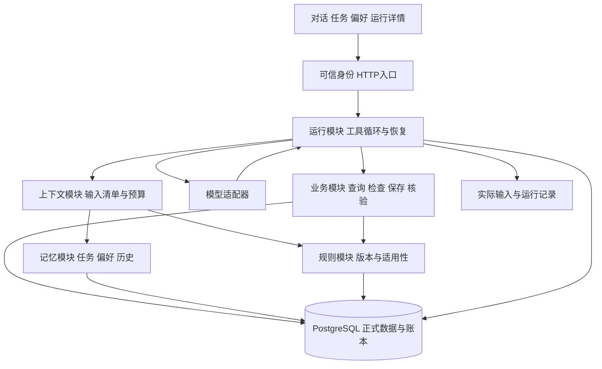

# 财税连续办理助手开发 SPEC

| 项目 | 内容 |
|---|---|
| 文档编号 / 版本 | SPEC / 1.2 |
| 日期 | 2026-10-26 |
| 配套需求 | [财税连续办理助手 PRD 1.2](./财税连续办理助手_PRD.md) |
| 用途 | 研发实现、接口联调、数据迁移、测试与交付契约 |
| 当前状态 | 开发设计，尚未实现；本文件中的测试和指标均未执行 |
| 规范含义 | “必须”为发布门槛；“建议”为可替换实现；替换不能改变行为与验收 |
| 文档关系 | 正式赛题优先；产品行为以配套 PRD 为准；本文件细化实现。旧研究文档仅供参考，冲突按本两份新版修订 |

本版变更：新增 §17 UI 设计与视觉验收，并更新 FR-16 的追踪和 WP-06 的交付要求。v1.1 已审查快照保存在 `文档归档/2026-10-25_v1.1/`，原独立审查对应该快照；UI-01—UI-14 当前全部未执行。

## 1. 实现决策与范围

首版采用 Python 模块化单体：FastAPI 提供 HTTP 入口，Pydantic 校验契约，psycopg 访问 PostgreSQL；React + TypeScript 提供轻量工作台。后端以 Python 3.12、PostgreSQL 16 作为初始验证目标，前端运行时及所有依赖在首次实现时锁定经联调的具体版本。这里是目标环境选择，不声称为最新版本或已经兼容验证。

一个后端进程即可承载请求与受控后台工作；一个 PostgreSQL 实例承载正式状态与持久工作表。首版不引入 Redis、独立向量数据库、图数据库、外部消息队列或多 Agent 执行拓扑。开发部署通过 Compose 提供数据库和后端，前端构建静态资源由后端提供；同时提供不用 Docker 的 PostgreSQL 连接方式。

模型调用通过 `ModelAdapter` 接口接入支持结构化工具调用的实际模型。供应商、模型 ID、工具协议、上下文上限在部署配置中显式给出。模型未配置时可以运行程序测试，但界面必须显示模型不可用，不能用固定回复冒充参赛运行。

技术选择理由：已有 D:\rsi 的 Python/PostgreSQL 会话、来源修订和恢复机制可选择性迁入；本题主要工作是 I/O、结构化状态和业务约束。Rust/Java 重写核心不会直接解决比赛验收项。前端 TypeScript 承担交互职责，业务真值与权限检查集中在后端。

### 1.1 已有资产复用限制

| 来源 | 可借鉴 | 本项目必须补齐 |
|---|---|---|
| 本地 RSI | 来源 revision、运行身份、持久工作、完整消息组选取 | 去除 OWNER=local；多用户企业隔离；真实工具协议；业务工具和规则 |
| DeerFlow | 写入筛选、后台生命周期、压缩前捕获 | 明确偏好同步提交；来源与作用范围校验 |
| LangGraph | 会话检查点与跨会话状态分离 | 任务按用户企业恢复，线程不成为唯一索引 |
| Letta | 核心状态固定装入，深层内容按需读取 | 任务真值由程序维护，不能被自由摘要改写 |
| Mem0 | 条目、修订、来源、去重 | 公司隔离与更正删除由本项目显式实现 |
| OpenViking | 概览与原文分层 | 重要规则完整读取，摘要只作为导航 |
| Graphiti | 来源依赖与时间有效性 | 使用关系表表达，不引入图数据库 |
| Codex/DSH 调研 | 工具循环、受控执行、上下文组织与可观察性 | 限定财税能力，不复制编码/联网工具栈 |

借鉴不等于安装全部框架，也不声称这些项目默认满足本 SPEC。源码证据与版本边界见[开源记忆机制调研](./开源记忆机制调研与升级建议.md)、[开源项目调研](./开源项目调研.md)。正式复制代码前必须核对相应版本许可证、保留声明并记录来源；机制重实现不冒充原创算法。

## 2. 模块职责与依赖



| 模块 | 对外接口 | 内部责任 |
|---|---|---|
| identity | `resolve_session`、`assert_access` | 可信用户、企业权限、身份固定、管理入口隔离 |
| business | `query_month`、`find_invoices`、`check_purposes`、`update_invoice`、`verify_operation` | Decimal、联合主键、权限、事务、操作去重、核验 |
| rules | `resolve_rules`、`manage_version` | 范围/时间/状态、原文与执行条件、冲突及启停 |
| memory | `load_core`、`search_history`、`apply_change` | 任务与偏好当前值、修订、来源、删除、依赖与排序 |
| context | `assemble`、`validate`、`compact` | 关键状态必需项、完整消息组、预算、来源有效性 |
| runtime | `accept_turn`、`resume_turn`、`cancel_run` | 模型循环、工作租约、重试、工具协议、完成状态 |
| trace | `record`、`read_run`、`export_run` | 实际请求与结果、事件顺序、访问控制、凭据排除 |

接口必须同时说明输入、输出、不变量、错误和幂等语义。业务校验只在 business 内实现一份；HTTP、模型工具和测试均穿过相同接口。规则正文引用与条件执行使用同一个版本记录。运行记录可以和主模块共用事务写入，不要求独立进程。

建议目录：`backend/app/{identity,business,rules,memory,context,runtime,model,trace,api}`、`backend/migrations`、`frontend`、`tests/{business,memory,runtime,integration,faults,model_eval}`、`fixtures`、`docs`、`scripts`。不要复制 RSI 整个项目或保留无关自进化逻辑。

## 3. 全局不变量

| 编号 | 不变量 |
|---|---|
| I-01 | 用户身份由可信会话解析；模型不能设置 user_id、权限或管理身份 |
| I-02 | 发票和银行记录以 `(company_id, business_id)` 联合定位，不能只用编号 |
| I-03 | 运行身份只有发票 purpose/note 的更新能力，禁止其他业务字段及银行写入 |
| I-04 | 每用户每企业最多一个 active/waiting_user 任务；任务不隶属于单一会话 |
| I-05 | 当前任务/偏好有唯一有效头，旧修订不能覆盖较新的来源指令和删除 |
| I-06 | 已受理/已记住/已保存/已核验分别对应真实的持久提交或读取条件 |
| I-07 | 关键任务字段、当前输入、必要规则与未知操作状态不能被预算静默丢弃 |
| I-08 | 当前金额/缺项来自业务工具；摘要和索引不替代正式数据 |
| I-09 | 业务修改、操作提交记录、相关任务进度在一个短事务提交 |
| I-10 | 用户更正/删除后，失效来源不能进入新的正式输入、写入或正式答复 |
| I-11 | 每项已受理工作有持久状态，处理水位不能跳过未解决缺口 |
| I-12 | 测试、历史和文档里的成功声明不得代替实际工具结果 |

I-10 在最终答复持久提交处线性化：删除早于答复提交则拒绝该答复；答复早于删除提交则属于过去已完成记录。网络投递可滞后，前端按事件版本更新，不把旧事件展示为新的有效记忆；无法撤回已经发送给模型的旧请求。

## 4. 数据模型

### 4.1 通用约定

内部 ID 使用 UUID；比赛用户/企业/发票编号保留原文本。时间戳用 `timestamptz` 保存 UTC，界面按 Asia/Shanghai 显示；业务日期用 `date`，月份用月份首日或校验后的 `YYYY-MM`。金额数据库用 `numeric(18,2)`，Python 用 Decimal，JSON 用两位小数字符串，禁止二进制浮点求和。

正式表为持久表。`revision` 为单调递增整数；`generation` 标记删除后新建、任务替换等不同生命周期；`source_seq` 为同用户受理顺序，在分配时锁定用户计数器。系统处理完成时间不能决定用户指令的新旧。

外键、联合唯一约束、检查约束必须在迁移中体现。模型自由文本放 text；结构化变更、输入清单和工具参数可用 JSONB，但不能将全部领域数据塞进一张通用记忆表。

### 4.2 业务和规则表

| 表 | 关键字段与约束 |
|---|---|
| users | `user_id PK, display_name, next_source_seq, memory_epoch`；身份列表取自样例 |
| companies | `company_id PK, name, aliases` |
| user_company_grants | `user_id, company_id PK, can_read, can_update`；更新意味着可读 |
| company_heads | `company_id PK, data_revision, rules_epoch`；业务写入与规则维护更新相应版本 |
| invoices | `company_id, invoice_id PK, invoice_date, seller, item, amount, purpose NULL, note NULL, revision` |
| bank_entries | `company_id, bank_id PK, transaction_date, direction, amount, counterparty, note`；direction 仅 income/expense，金额为正 |
| import_batches | `batch_id, source_hash UNIQUE, imported_at, row_counts, baseline_id`；禁止普通导入覆盖现有业务记录 |
| rule_versions | `rule_version_id PK, rule_code, display_name, business_version, effective_from, effective_to NULL, status, topic, full_text, condition_json, source_ref, content_revision`；同 code/version 唯一 |
| rule_scopes | `rule_version_id, company_id PK`；全局初赛规则显式关联两家企业，避免无范围匹配 |
| operations | `operation_id PK, user_id, company_id, invoice_id, source_id, intent_key UNIQUE, request_hash, before_revision, after_revision, patch, before_values, after_values, state, verification_state, last_error, committed_at`；`(user_id,source_id,company_id,invoice_id)` 唯一，冻结同来源同目标的已接纳 patch |

规则状态为 `draft/active/disabled`。启用的原文、条件与业务版本不可原位覆盖；修改创建新版本。停用允许改变状态并增加 revision/rules_epoch。条件类型为 `money_summary`、`bank_read_only`、`purpose_all`、`purpose_threshold`；门槛金额用十进制字符串，比较操作首版固定 `gte`。

运行数据库角色对 bank_entries 没有 INSERT/UPDATE/DELETE 权限，对 invoices 只授予 purpose/note/revision 的 UPDATE 权限；导入和规则维护用独立本地管理连接。SQL 同时保留参数与权限校验。角色权限是额外的约束，不能替代用户企业 ACL。

### 4.3 会话、来源和工作表

| 表 | 关键字段与约束 |
|---|---|
| sessions | `session_id PK, user_id, selected_company_id NULL, created_at`；创建后用户不可更换 |
| turns | `turn_id PK, session_id, user_id, client_request_id, request_hash, source_seq, status, pending_clarification JSONB NULL, continuation_of_turn_id NULL, resolved_by_turn_id NULL, active_run_generation, final_response_ref`；`(user_id, client_request_id)` 唯一 |
| runs | `run_id PK, turn_id, generation, state, config_version, started_at, finished_at, final_source_id`；`(turn_id,generation)` 唯一，generation 与 turn 当前执行代次关联 |
| sources | `source_id PK, turn_id NULL, user_id, role, kind, scope_kind, content, revision, content_hash, source_seq, created_at, recall_state`；scope_kind 为 user_private/company_scoped |
| source_scopes | `source_id, company_id PK`；用户全局偏好标记 user_private，跨企业消息显式列其有权范围 |
| work_items | `work_id PK, kind, source_id, source_revision, processor_version, state, attempts, lease_until, fencing_token, last_error`；处理身份唯一 |
| source_assessments | `(source_id, revision, purpose, processor_version) PK, state, result_refs, error`；state 为 pending/accepted/no_change/failed/invalidated |
| source_progress | `user_id, purpose PK, contiguous_seq, unresolved_refs`；连续水位只跨已结案来源，不掩盖缺口 |
| run_events | `(turn_id,event_seq) PK, run_id, kind, tool_call_id NULL, input_ref, result_ref, state, created_at`；event_seq 在同 turn 跨 run generation 单调递增，支持恢复后 SSE 重放 |
| tool_executions | `(run_id, tool_call_id) PK, name, arguments, arguments_hash, state, operation_id NULL, result_source_id NULL`；执行前持久保存，恢复匹配原调用与结果 |
| context_snapshots | `context_id PK, run_id, model_step, payload, payload_hash, manifest, token_count, count_kind, created_at`；保存实际发送内容，不含认证头 |
| result_views | `view_id PK, user_id, session_id, company_id, period, ordered_keys, data_revision, rules_epoch, result_source_id, displayed_event_seq NULL, status`；记录实际展示顺序，分页各有独立 view_id |

跨企业原文不允许在仅授权单企业的普通检索中整段暴露；首版保守做法是要求调用方拥有该来源全部企业权限，并在装配时选择与当前目标相关的完整语义片段。用户全局偏好原文不得附带未经授权的企业资料。

source_seq 分配给受理的用户消息或管理指令，派生助手/工具来源继承父指令序号，使用事件序号区分顺序。连续水位以“该用户指令所需处理项均已结案”为单位推进；无工作项的序号必须有 no_change 记录，不能因只统计部分来源而跳过缺口。

### 4.4 任务、偏好和派生数据

| 表 | 关键字段与约束 |
|---|---|
| task_slots | `(user_id, company_id) PK, current_task_id NULL, generation, revision, authority_source_seq`；永久保留的企业任务位置，删除后仍保留顺序与代次 |
| tasks | `task_id PK, user_id, company_id, period NULL, intent, status, generation, revision, authority_source_seq, unresolved_json, last_check_ref, checked_data_revision, checked_rules_epoch, deleted_at`；intent 为 query_month/explain_rules/complete_purposes；active/completed 必须有 period，waiting_user/cancelled/deleted/replaced 可保留 NULL |
| task_revisions | `(task_id, revision) PK, change_type, snapshot, source_refs, source_seq, created_at`；保存接受的修订 |
| preferences | `preference_id PK, user_id, scope_key, stable_key, value, status, generation, revision, authority_source_seq, source_refs, deleted_at`；`(user_id, scope_key, stable_key)` 唯一 |
| preference_revisions | `(preference_id, generation, revision) PK, value, status, source_refs, source_seq` |
| memory_dependencies | `dependent_type, dependent_id, dependent_revision, source_type, source_id, source_revision, source_generation`；摘要与记忆的依赖可校验 |
| summaries | `summary_id PK, user_id, scope, covered_sources, memory_epoch, task_revision, content, status, generation`；可重建 |
| history_index | `source_id, source_revision, scope, searchable_text, index_version`；仅辅助定位，不承担当前值 |
| memory_change_ops | `change_id PK, user_id, request_id UNIQUE, target_type, target_id, expected_revision, action, state, result_ref`；管理操作去重 |

`tasks` 增加 partial unique index：`UNIQUE(user_id, company_id) WHERE status IN ('active','waiting_user')`。任务历史与偏好历史不能绕过当前有效头作为普通记忆返回。

task_slots.current_task_id 只指向该用户该企业当前未完成任务，完成/取消/删除时清空但保留 slot。创建、替换、删除时锁 slot 并更新 generation/revision/source_seq；旧来源不能因 current_task_id 已为空而重建已删任务。新建需要晚于 slot.authority_source_seq 的明确用户来源，重复同一来源只返回已有结果。

偏好 `scope_key` 使用 `@user` 或企业编号，避免 NULL 唯一约束语义导致重复。`stable_key` 首版提供展示顺序、回复详略、列表格式等键，另允许有来源的自定义说明键；管理和撤销使用 preference_id。自定义项不能转化为规则、权限或默认业务写入授权。

`unresolved_json` 保存未明确的信息及引用，例如尚缺哪张票的用途，必须带来源；`last_check_ref` 保存检查结果位置。缺项列表带 data_revision/rules_epoch，仅是快照。任务是否完成由当前检查判断。

### 4.5 必需索引

发票/流水建立 `(company_id, date)`；任务建立 `(user_id, company_id, status)`；偏好建立 `(user_id, scope_key, status)`；来源建立 `(user_id, source_seq)` 和范围关联索引；工作表建立 `(state, lease_until)`；操作建立用户企业查询与 intent_key 唯一索引；规则建立企业、主题、状态与生效日期查询索引。

数据量小时历史文本先使用参数化包含匹配与明确编号过滤，返回完整语义上下文。无需为中文检索先引入分词平台；记录无命中案例后评估全文或向量 Adapter。

## 5. 数据导入与业务计算

导入器读取 S3 的企业用户、发票和银行流水明细，识别字段标题而非把装饰行当数据。日期解析为 date，编号保留字符串，空白用途/备注保持 NULL 或空白原值，不写入“未填”占位字。

Excel 数值先用 `Decimal(str(value))` 转换并按两位小数规范化，拒绝非数、无穷和不合法方向/日期；只读取明细作业务数据，不把“说明”页的浮点合计作为答案。输出原始行号及错误原因。整个批次先验证后事务导入，校验 2 企业、2 用户、40 发票、48 流水和权限。

首次导入使用 source_hash 去重。相同文件重复导入返回已有批次；非空业务库收到不同样例导入请求时拒绝覆盖，要求显式创建独立演示/测试环境。生产入口不暴露重置按钮。测试重置仅作用于独立测试库并校验目标标识。

月份过滤为 `[当月首日, 下月首日)`。所有金额在数据库或 Decimal 中完整汇总后返回，JSON 为 `"9622.06"`。分页明细不影响完整总额和总数；查询成功空结果返回 `has_records=false` 与 `"0.00"`，权限/数据库错误返回错误对象，不能套用空集合默认值。

一个查询/检查结果内的 ACL、数据行、合计、总数、适用规则与 company heads 必须在同一个短 `REPEATABLE READ READ ONLY` 事务读取，随后结束事务再调用模型。返回的 data_revision/rules_epoch 对应该快照；多个工具的结果各自标记版本。跨请求分页游标绑定查询范围和数据/规则版本，版本变化返回 STALE_CONTEXT 并要求重新查询，不能把不同版本页拼成完整清单。

用途缺失判定为 NULL 或 Unicode 空白清理后为空；条件按正式规则版本执行。基线只对 2026-09 运行用途完整性检查，其他月份返回 `PERIOD_UNSUPPORTED`。备注与用途各自独立。

## 6. 规则选择和更新

`resolve_rules(auth, company_id, business_date_or_period, topics)` 先检查访问权限，再过滤企业 scope、active 状态和生效区间。`effective_from` 包含，`effective_to` 不包含。停用版本无论文本多相似均不得入选。

同一企业、主题、业务日期只能有一个可执行版本；维护时用公司 head 锁检查重叠，冲突返回 `RULE_CONFLICT`。不同主题可以共同返回，例如统计与银行解释返回 R001/R004。版本号是显示标识，不能按字符串大小决定适用性。

初赛种子：R001 1.0 两企业 2026-01-01 active；R002 1.0 C001 2026-08-01 disabled；R002 2.0 C001 2026-09-01 active；R003 1.0 C002 2026-08-01 active；R004 1.0 两企业 2026-01-01 active。原文完整保留。

首版维护可执行用途条件要求生效/结束边界在月首，以保证月度检查单一规则版本；不支持的日中/月中变更保存 draft 并说明无法启用。此为首版能力范围，不能把它说成比赛要求。业务规则将来需要按日变化时，扩展为逐发票日期选择并增加测试。

更新分为创建草稿、校验、启用。维护者提供原文、结构化条件与明确替换对象；使用已支持条件的受控模板核对门槛及适用性，保留导入原文和校验结果。任意自然语言正文的语义一致性不能仅靠模型自动证明；不匹配模板/无法确认一致的版本不启用。显式替换在同一事务停用旧版、启用新版并更新 rules_epoch。停用后无适用规则则返回 `RULE_UNAVAILABLE`，不回退旧规则。

示例管理契约（CLI 名称为本项目待实现命令）：`app rules import <file>`、`app rules list --company C001`、`app rules show <version-id>`、`app rules create-version <json>`、`app rules activate <version-id> --replaces <old-id>`、`app rules disable <version-id>`。CLI 输出已提交状态和新版本；密钥通过环境或受保护配置传入，不出现在命令参数及日志。

## 7. 记忆写入与生命周期

### 7.1 原文受理

`accept_turn` 在短事务中校验会话，分配 source_seq，保存 turns、sources、scope 和 turn 工作项。事务提交后才返回 HTTP 202 受理成功。用户级 client_request_id 与内容 hash 绑定；同 ID 同内容返回同 turn_id，同 ID 不同内容返回 `IDEMPOTENCY_CONFLICT`。

模型在事务外运行。抽取任务、偏好和修改意图产生提案，包含目标、范围、来源位置与期望版本。程序验证来源确实存在、说话者和范围正确、引用原文匹配、字段允许、目标版本与执行身份有效。来源匹配只能证明有引用，不能单独证明任意语义解释正确；语义歧义需要澄清并由真实模型用例验收。

明确的“记住/更正/删除”在本轮完成提交后才确认成功；摘要和文本索引可异步更新。每条来源分别记录 pending、accepted、no_change、failed 或 invalidated；已评估不产生变化不等于证明全部语义都被理解。

管理按钮产生的明确操作保存为 `kind=user_action` 的结构化来源，记录动作、目标、值和客户端请求 ID，不伪造用户说过的自然语言原话。它与聊天来源共用用户 source_seq、版本、删除与操作去重约束。

### 7.2 任务状态机

| 当前状态 | 触发 | 新状态/行为 |
|---|---|---|
| 无任务 | 企业明确，开始用途检查/补全 | 有缺项→waiting_user；尚需工具→active；无缺项经当前检查→completed |
| 无任务 | 企业明确的金额/规则查询缺少月份等必要信息 | 建 query_month/explain_rules waiting_user，缺失字段保留 NULL 并写 unresolved_json |
| active | 需要用户补信息 | waiting_user |
| waiting_user | 用户补充且目标清楚 | active，执行工具后重查 |
| active/waiting_user | complete_purposes 当前检查必填缺项为零 | completed |
| active/waiting_user | query_month/explain_rules 已补齐必要范围且取得完整成功结果 | 通过对应完成条件后 completed；查询失败或规则不足不算完成 |
| active/waiting_user | 明确取消 | cancelled，不撤销业务数据 |
| active/waiting_user | 明确替换目标 | 旧任务 replaced，新 task_id/generation，事务中维持唯一约束 |
| 任意可见任务 | 明确删除目标 | deleted，退出普通查询和自动恢复，保留最小删除审计 |

任务月份或目标更正写新 revision，已执行操作继续归属原企业与记录。普通一次查询不创建替换任务。只读用户可建立自己的检查任务，但任何补充工具都必须拒绝写入。

企业尚未明确时，turn.status=waiting_user 并持久保存待澄清字段，不先猜企业创建 task_slot。新会话恢复可列出该用户最近未结案待澄清 turn 的简短意图，且不加载未授权企业内容；有多个候选则澄清。企业确定后，将该 turn 关联到对应企业任务或完成一次查询。已有该企业任务且新目标需跨轮、无法直接利用既有范围完成时，先澄清是否替换，不增加第二个持续任务。该等待阶段仍属于已记录对话，不声称已有企业任务。

待澄清轮的 work item 在追问正式提交后标为 done，不占着租约等待用户。用户补充形成新的 turn/source；模型明确关联后写 continuation_of_turn_id，并在同一记忆事务将旧 turn 标 resolved、写 resolved_by_turn_id、增加 memory_epoch。旧问题不再作为待办候选重复恢复。关联歧义时先追问，不按“最近时间”强行连接。未产生补充的新会话不会自动执行旧修改。

pending_clarification 内保存 state、generation、revision、authority_source_seq、已确认范围、缺失字段、source_refs 和可选 task_id/generation。企业未知的事项也支持列表查看、取消、删除：取消走 turn cancel，删除仅将该待澄清头标 deleted 并保留 tombstone。管理动作生成新的 user_action/source_seq，锁 user/turn 后校验 expected_revision，增加 memory_epoch，终止对应旧 run 资格。迟到来源不能根据原始 waiting_user 消息重建它。旧事项已 resolved/cancelled/deleted 时，不再接受其补充关联；需要新任务时使用用户明确的新来源。

任务更新使用 expected_revision；冲突时重新读取，不静默覆盖。恢复后的旧 worker 必须同时通过 task_id、generation、revision、来源顺序和 fencing_token 校验。旧来源即使后来读到新 head，也不能覆盖 authority_source_seq 更晚的修订。

用途补全任务完成只能走内部 `complete_task_from_check`：在锁住 user、company、slot、task 的短事务中，校验 check_ref 确属同企业/月、完整缺项总数为零、task revision/generation 与当前 data_revision/rules_epoch 均相符，再提交 completed 并清空 slot。检查后数据或规则变化则拒绝旧检查结果并重查。有关写操作仍待核验时，答复不得宣称所有写入都已核验。

上述 complete_task_from_check 只处理 complete_purposes；query_month 使用内部 complete_task_from_query 校验同企业/月、全部请求指标均查询成功及对应版本；explain_rules 使用 complete_task_from_rules 校验所需主题均有有效版本和可引用原文。三个接口共用版本与 slot 条件提交逻辑，不把模型直接提出的 completed 当完成证据。信息齐全的一次性查询可以不创建持久任务。

明确跨企业更正持续任务时，按固定顺序锁两家企业和 task_slots：原任务置 replaced，目标企业创建新任务；已执行操作不转移。目标企业已有未完成任务而处理意图不明确时返回 NEEDS_CLARIFICATION。普通跨企业查询仅改变当前上下文，原任务保留。

### 7.3 偏好更正、删除与重新建立

同 `(user, scope, stable_key)` 的有效头唯一。更正在一个事务写新修订、更新当前值、增加用户 memory_epoch、登记依赖失效。请求包含 expected_revision，冲突返回 `VERSION_CONFLICT`。本轮临时要求不写长期表。

删除写 tombstone、增加 generation/revision 和 memory_epoch，立即阻止读取。无需等待后台清掉索引才能生效。旧源、旧摘要、旧抽取即使仍有文本，也不能作为新当前值。之后用户明确重新要求记住，且来源顺序晚于删除，可新建有效 generation；普通重试或旧历史匹配不能触发重建。

任务删除使用相同代次与失效机制。偏好/任务管理必须在精确 ID 操作上再次检查 user_id 和 scope，不能以“知道 ID”作为授权。

pending_clarification 关联 task_id/generation（有任务时）。任务完成、取消、删除或替换时，同一事务结束关联的未解决追问并使其旧视图失效；它们不再进入 load_core 的待澄清候选。防止任务虽然删除，旧追问却在新会话通过新的补充来源重新激活它。新建任务需要用户明确提出新的任务目标。

### 7.4 依赖失效与原文处理

摘要、历史片段和候选索引记录来源 revision 与相关 memory head。加载候选后回正式库复核，不直接使用索引正文。

更正/删除后，将受影响的来源片段标记为普通记忆不可用。首版可以保守排除含失效记忆的整个旧消息，避免仅删除条目却从原文重新提取；其他必要任务状态从正式表读取。用户在受控历史管理入口可看到“已更正/已删除”审计标记，普通问答不恢复旧有效值。全面原文擦除不属于本版公开功能，不能在界面声称已彻底抹除。

## 8. 记忆查找与上下文装配

### 8.1 四条取数路径

| 路径 | 输入 | 处理 | 输出 |
|---|---|---|---|
| 核心任务 | auth、明确 company_id | 读取当前未完成任务和必要修订 | 任务范围、状态、未解决信息、版本 |
| 有效偏好 | auth、目标 company_id | 读取 @user 与企业 scope 的 active 项，同键企业项优先 | 当前值、来源、revision/generation |
| 规则 | auth、企业、月份、主题 | 第 6 节的确定筛选 | 完整相关规则、名称版本、执行条件 |
| 历史原文 | auth、scope、实体/日期/查询文本 | 先范围过滤，再编号/文本查找，最后来源复核 | 必要原文、说话者、时间、引用 |

核心任务和偏好不参加统一 top-k 竞争。企业不明时只加载用户有权的任务标题/企业候选供澄清，不拼接多个企业的完整业务历史。选择企业后重新装配该范围。

`load_core` 同时读取当前用户 status=waiting_user 且未关联解决的待澄清 turn 摘要（已确认范围、缺失字段、source_id），用于接住尚未确定企业的补充。它们来自精确状态查询，不能因文本搜索没命中而消失；任务已关联的追问与该任务合并展示，避免同一事项重复。候选过多或预算不足时先要求用户选择，不将多个候选完整业务内容混入输入。

`search_history` 默认候选上限 20、返回上限 5，参数可配置；先在完整合法范围按条件查询再排序，不能先截最近 20 条然后假称已搜索全部历史。明确发票号优先于模糊文本；文本匹配按匹配强度排序，时间仅作同分次序。返回 `has_more` 和游标；需要完整历史时分页，不把 top-5 说成全部。

历史无命中返回 `not_found`，数据库/索引故障返回对应错误。核心任务读取失败时停止依赖动作；可选历史失败但核心状态充分时可以继续，需记录降级。如确有语义漏召回，P2 增加词法与向量独立候选、融合排序、正式来源复核，原有核心路径保持。

### 8.2 上下文预算

模型配置必须包含上下文上限 C、输出预留 O、工具协议及计数方式。首版输出预留默认 2048 token，输入目标上限为 `min(16000, C-O-安全余量)`；安全余量默认 C 的 5%，需联调验证。16000 是开发初始预算，不是模型能力或性能承诺。C 无法确认时禁止启动真实调用。

计算范围包含系统提示、工具 schema、消息、记忆、规则和工具结果。可用准确 tokenizer 时记录 exact；仅估算时记录 estimated、估算方法和余量，不把 UTF-8 字节数称为 token。若供应商仍返回超长错误，重新缩减可选内容一次；必需内容不足或仍超限则 `CONTEXT_CAPACITY_EXCEEDED`。

装配顺序：可信身份与能力约束→当前完整用户消息→有效任务/适用偏好→本次动作所需完整规则和结果→闭合近期消息组→可选摘要/历史。重要规则短，直接保留条件与例外；工具明细通过分页和确定性汇总减少，不随机截掉缺项。

manifest 与实际 payload 同时生成并保存 hash，包含用户/企业、任务 ID/generation/revision、memory_epoch、规则 ID/revision/rules_epoch、业务结果 data_revision、来源 spans/revisions、闭合工具组、预算和实际选择理由。校验必须检查 payload 本身对应字段，不能只检查 manifest 的 selected 标记。

### 8.3 压缩协议

1. 确认原文已保存，覆盖区间来源有完整处理状态；存在未记账缺口或关键失败则不能切换成只含摘要的视图。
2. 冻结来源集合、task head、memory_epoch 和已有摘要代次，仅选择闭合旧消息组。
3. 在事务外生成引用原文的摘要，保留主体、月份、否定、更正、未解决事项及真实操作状态。
4. 核对来源、必需状态、工具配对、版本和整体预算。程序校验不能由模型一句“无遗漏”替代。
5. 以期望版本提交新摘要指针。期间更正/删除则废弃候选；失败保留原状态。核心任务始终直接读正式表。
6. 摘要存在歧义时读原文或澄清；压缩并不表示删除消息。

首版需要支持可配置低预算触发压缩以便测试，不能只等待自然长对话偶然触发。生产与测试预算在报告中标明。

## 9. Agent 工具循环与写入授权

### 9.1 模型适配器契约

`ModelAdapter.complete(ModelRequest) -> ModelResponse`。请求包括 messages、tools、model_id、output_limit 和可用参数；返回 text、tool_calls、finish_reason、usage（如供应商提供）。工具调用必须有唯一 call_id、名称和可校验 JSON 参数。不能从自由文本中用正则猜工具调用。

未知工具、无效 JSON、缺少参数或不支持的额外字段返回结构化错误供模型修正，不能直接执行。一次返回多个工具时，读取可按需求并行；首版写入按返回顺序串行，任何依赖前一个结果的动作等下一轮。不得并行共享可变任务上下文。

### 9.2 标准循环

1. 领取 turn 工作并校验执行代次，恢复已有事件和未完成工具调用。
2. 加载可信身份、当前消息和必要状态，装配并保存实际输入；发送前复核 head。
3. 调用真实模型。模型选择查询、追问、工具调用或结束。
4. 校验工具 schema、范围及授权来源，分配/读取持久工具执行记录。
5. 执行工具，将实际结果作为匹配 call_id 的 tool 消息保存并回填。
6. 加载本轮自身变更后的新状态，继续模型决策。旧工具结果的 revision/as_of 永久对应原快照；若还需要它表示当前状态，必须重新查询并生成新的结果引用，不能给旧结果重贴新 revision。只读取到新 head 不算取得了新版业务结果。
7. 最终答复提交前复核关键版本和操作结果，将答复与终态事件一起提交，然后展示。

开发默认上限：每 turn 最多 8 次模型调用、16 次工具调用、累计处理 180 秒；单次模型请求 60 秒超时。均可配置并记录，不是性能 SLA。超限保留已提交结果，报告尚未完成项。参数错误可在调用预算内由模型修正；同一确定错误不无限重试。

模型网络失败允许同请求上下文最多一次重试；已执行工具的结果从账本恢复，不能因重新生成模型输出重放写入。数据库读在确认未产生副作用时可最多重试一次；写入未知状态先按 operation_id 查询。

### 9.3 业务工具目录

工具对模型不暴露 user_id、凭据、数据库连接、fencing_token 或任意 SQL。下列所有 scope 由宿主与当前用户权限联合核验。

| 工具 | 模型参数 | 成功输出关键内容 |
|---|---|---|
| `query_month` | company_id、period、metrics | 三项金额或指定项、各类条数、has_records、as_of、data_revision、规则引用 |
| `find_invoices` | company_id、可选 period/ids/seller/item、cursor | 可定位发票、revision、总数、has_more；提供消解指代用 view_id |
| `get_rules` | company_id、period、topics | 规则完整原文、名称版本、适用性与 revision |
| `check_purposes` | company_id、period、cursor | 完整缺项总数、当前页编号、view_id、has_more、rule_refs、data_revision |
| `update_invoice` | company_id、invoice_id、patch、expected_revision、source_refs/selection_ref | operation_id、commit_state、保存值、revision、verification_state |
| `get_task` | company_id | 当前用户任务或无任务，带版本 |
| `change_task` | company_id、action、target_id/expected_revision、明确字段、source_refs | 新状态及 revision；不能通过它声明未核验任务已完成 |
| `manage_preference` | action、scope、target_id/key/value、expected_revision、source_refs | 当前有效值或删除状态及版本 |
| `search_history` | company_id/用户私有范围、query、可选实体/日期、cursor | 合法原文候选、来源、版本与 has_more |

`patch` 仅含 purpose/note，值为字符串或 null，省略字段表示不修改，null 表示明确清空；默认文本长度上限每字段 2000 字符，超限请求用户缩短，不能静默截断。管理 action 采用枚举并按动作校验必填字段。历史、任务、偏好的文本长度也必须在 schema 中设上限，超限不接受并保留原状态。

### 9.4 明确修改与指代

宿主记录源自当前 turn 的修改意图，或当前用户对未完成澄清的明确补充。来源引用必须是该用户可读、仍有效的原话；当前补充可引用任务已确认的企业/发票定位。程序核对原文和实际 patch 值，不能把助手建议、票面项目或旧工具结果当作用户新提供的用途。

“第一张填办公资料整理”使用最近一次向该用户展示的完整有序结果 view_id/row_index 定位，并检查企业、数据版本和未发生范围切换。无可靠 selection_ref 或多个可能列表时追问。当前用户说“继续”只授予恢复与检查，不自动批准旧 patch。

find_invoices/check_purposes 生成持久 result_view。只有实际展示给用户后才写 displayed_event_seq；工具结果进入模型但未展示不构成可用指代。用户看到的编号列表由结构化结果渲染，顺序与 ordered_keys 一致；模型文字不能重新编号制造另一套顺序。分页每页独立编号和 view_id。查询版本变化、企业切换或候选列表有歧义时，使原指代失效并重新定位/澄清，不能把旧“第一张”绑定到刷新后的另一张。

目标和文本清楚时不再要求额外确认。模型的语义判断通过真实模型用例验证；程序证据校验不声称解决任意自然语言授权理解。无法验证目标或内容时返回 `NEEDS_CLARIFICATION`，不提交。

同一来源对同一发票最多接受一个最终 patch；同一表达给出冲突值时先澄清。不同发票可分别处理，批量上限默认 10 张；超过则分页计划与逐项状态可见，不能静默忽略其余。

同一句同时指定某张发票的用途和备注时，模型先组合这张发票的完整 patch，再由宿主冻结并执行一次；不能先执行用途、再以同来源另发备注 patch。用户在下一条消息补充或更正形成新 source_id，可产生新的合法操作。真实模型用例必须覆盖同票双字段，发现遗漏时如实报告未完成，不能把冲突拒绝伪装成全部成功。

## 10. 写入事务、并发与恢复

### 10.1 发票修改事务

宿主在首次执行前创建稳定 operation_id，并绑定 `intent_key=(user_id, source_id, company_id, invoice_id)`；同一来源同一目标的已接纳 patch 持久冻结。操作 request_hash 绑定可信用户、来源、企业、发票和规范 patch；易变的模型 call_id 和重新读取的版本不改变已提交操作身份。首次 expected_revision 单独保存为写入前提。同来源同目标提出不同 patch 返回 INTENT_CONFLICT，不能用新 patch hash、新 call_id 或新 operation_id 再写一次；新的明确用户更正使用新 source_id。参数未通过基本校验前不冻结意图。

短事务执行顺序：

1. 校验当前可信身份、企业权限、操作归属和请求指纹。先读取 operation_id/intent_key 对应终态：已经 committed/no_change/rejected 则返回该操作已有结果；需要当前值时另行查询。此分支不按旧 expected_revision、旧 task revision 或旧上下文否定已提交事实。
2. 仅对未提交操作，按统一顺序锁 user head→turn→work item→company heads（企业 ID 排序）→invoices（联合 ID 排序）→task_slots/tasks。锁后再次读取终态，防止并发重试刚刚完成。
3. 检查 turn.active_run_generation、当前 run generation、work fencing_token 与有效租约同时匹配，再检查用户权限、仍有效来源与修改意图、首次目标 expected_revision、task generation 和必要规则 epoch。校验失败不写业务数据。
4. 当前值已等于 patch 则登记 no_change；否则更新允许字段和发票 revision，增加 company data_revision。
5. 写 operation 的 before/after 与 committed/no_change 状态；更新相关任务的操作引用和待复核标记。任务完成由下一次当前检查确认，不能在此猜测全部完成。
6. 写持久事件并提交。任一步失败全部回滚。终态重放只返回历史结果，不取得新的写入或正式答复发布资格，最终输出仍经过当前版本检查。

提交后在新读取事务重新查询目标字段与当前 revision。相同则 verification_state=verified；读失败则 pending，回复已提交待核验；发现之后被另一有效操作修改则 changed_since_commit，说明本次曾提交但当前值已变化，不能说当前仍为旧值。

操作状态：prepared→committed/no_change/rejected；崩溃导致客户端未知时先查数据库。`committed` 与 `verification_state` 独立，不能把核验失败改写为未提交。批量每张独立事务，回复逐项汇总。

### 10.2 并发与最终输出

同用户的普通 turn 按 source_seq 串行处理，降低多会话相互覆盖；不同用户可以并行。任务/偏好管理和取消入口可独立提交，使正在等待模型的旧 run 失效。自然语言更正按受理顺序经过理解后提交，不能把“已收到”当作“已更正”。

所有任务/偏好变化锁 user head 并增加 memory_epoch；业务变化锁 company head；规则管理锁受影响公司 head。最终答复提交事务按相同顺序对 user、turn、work 和涉及公司 heads 取共享锁，检查 run generation/fencing_token/租约及输入观察到的版本、来源和操作状态，检查通过后保存答复与事件，再释放锁。相关更正/删除必须取得冲突锁，因此存在明确先后关系。

取消在短事务中按 user→turn→work 顺序加排他锁，递增 turn.active_run_generation 与工作执行代次，记录 cancelled 并提交事件。写事务/最终答复若先提交则属于取消前已完成结果；取消先提交则旧 run 不能随后提交。不能只取消前端请求或只改 work 状态。worker 领取事务只锁工作行并立即提交，不在持有工作行时反向等待 user/turn 锁。

版本变化后可重新加载并最多重建一次回答；涉及写入时仍检查原操作账本，不重复保存。持续冲突则结束为 `interrupted` 并说明已提交和待处理内容。已发送模型输入无法撤回，但失效返回不提交为新正式回答。

普通最终文本在上述校验后一次性发布；处理期间只发送真实阶段进度。前端使用 event_seq 和 memory_epoch 忽略乱序重复事件。已提交的历史答复保留其时间和依据，不代表永远当前。

### 10.3 工作领取与重启

持久工作表采用事务领取与租约，默认租约 90 秒、每 20 秒续租；模型等待期间续租由独立协程承担。重新领取增加 fencing_token，所有最终状态更新检查 token。超时不表示外部模型调用一定未发生，可能产生额外模型费用，不能承诺外部调用恰好一次。

后台结果、来源评估状态和工作完成状态在同一事务提交。处理身份为 source/revision/purpose/processor_version；重复领取不产生重复修订。先失败的来源保留缺口，后续独立来源可处理，但 contiguous_seq 不能越过缺口。

启动恢复 ready/过期 running 工作。对未完成写操作先查 operations，已提交只核验或返回，未提交且执行身份/源仍有效才续做；失效源终止。普通启动不导入原始 Excel，不重新执行全部历史事件。

### 10.4 持久化与备份

核验 PostgreSQL `fsync`、`full_page_writes`、关键事务 `synchronous_commit` 与可持久存储，不能使用临时或 UNLOGGED 表承载关键状态。底层介质需履行刷新语义。

备份包含正式数据、来源、修订、删除代次、操作账本、规则和处理水位；派生索引可重建。每份备份记录一致恢复点、备份 ID、完成时间及校验信息。只恢复旧备份时保持 maintenance 状态，核对其后回执/更正/删除是否可用日志补齐；无法补齐时不得宣称最新状态已恢复，也不得自动开放可能复活的记忆。

首版恢复演练覆盖恢复点内完整性；单机磁盘全部损坏的最新确认数据零丢失不在范围。要扩大保证，先提供独立同步副本与故障验证。hash 只能检测内容变化，不能替代真实副本。

## 11. HTTP 与前端接口

### 11.1 通用约定

所有路径为 `/api/v1`。可信演示登录 `POST /demo/login {user_id}` 从允许列表创建带 HttpOnly cookie 的会话；仅在 `DEMO_MODE=true` 且本地演示部署开放，UI 明示模拟身份选择。该入口不是生产身份认证。后端本地绑定，跨域和 cookie 按同源配置。部署到公共网络需另行接入真实认证，不纳入本赛题演示范围。

认证之后业务请求不接受自报 user_id。资源不存在与无权访问统一为对调用者不可见的资源错误，不泄漏对象内容。HTTP 状态采用 400 参数错误、401 未认证、403 已知企业禁止访问、404 不可见资源、409 冲突、422 不支持条件、503 依赖不可用。

公共错误结构：`{code, message, retryable, request_id, details}`；details 不含凭据或其他范围资料。业务工具返回 `{ok, data, error, evidence_refs, versions}`；金额为字符串、错误与空结果不同。

### 11.2 端点清单

| 方法/路径 | 请求 | 响应/语义 |
|---|---|---|
| GET `/me` | cookie | 用户及可访问企业和权限 |
| GET `/sessions` | cursor 可选 | 当前用户会话列表及 has_more，用于刷新后恢复 |
| POST `/sessions` | selected_company_id 可空 | session_id；绑定当前身份 |
| GET `/sessions/{id}/messages` | cursor 可选 | 当前用户可读的持久对话及事件版本；历史状态与当前有效状态分开标记 |
| PATCH `/sessions/{id}` | selected_company_id | 校验企业权限，切换当前选择并使旧列表指代失效；用户身份不可修改 |
| POST `/sessions/{id}/turns` | client_request_id、text | 202：turn_id、status、events_url；只确认原文受理 |
| GET `/turns/{id}` | 无 | 当前 run、最终答复、已提交/待核验操作状态 |
| GET `/turns/{id}/events` | Last-Event-ID 可选 | SSE；按持久 event_seq 重放，不重复发有效操作 |
| POST `/turns/{id}/cancel` | request_id | 增加执行代次并取消未提交动作；已提交结果保留 |
| GET `/pending-clarifications` | cursor 可选 | 当前用户尚未解决的待澄清事项及 revision；关联任务的项去重展示 |
| DELETE `/turns/{id}/pending-clarification` | request_id、expected_revision | 停止该事项恢复并保存 tombstone；不删除完整会话原文 |
| GET `/tasks?company_id=...` | scope | 当前用户可见任务及版本，默认不含 deleted |
| PATCH `/tasks/{id}` | request_id、expected_revision、允许的月份/目标或 cancel/replace 动作 | 同业务规则执行，禁止直接声明未经检查的 completed |
| DELETE `/tasks/{id}` | request_id、expected_revision | tombstone；不撤销发票数据 |
| GET `/preferences?company_id=...` | scope | 当前有效项及来源、作用范围 |
| POST `/preferences` | request_id、scope、key、value、用户输入文本 | 创建来自该管理输入的 source 与明确记忆 |
| PATCH `/preferences/{id}` | request_id、expected_revision、value、用户输入文本 | 同样创建 source，新 revision |
| DELETE `/preferences/{id}` | request_id、expected_revision | 删除回执与新 generation |
| GET `/companies/{id}/invoices` | period、ids、cursor | 供用户核对的当前记录、revision、分页信息 |
| GET `/rules` | company_id、period、topic | 当前用户可读规则及版本，管理更改只走 CLI |
| GET `/runs/{id}` | 无 | 当前用户的实际输入、工具、来源版本、结果 |
| GET `/runs/{id}/export` | 无 | 去凭据的 JSON/JSONL，仍执行用户归属检查 |
| GET `/health`、`/ready` | 无 | 进程与数据库/迁移就绪；不输出连接信息 |

SSE 事件包括 accepted、model_started、tool_started、tool_finished、waiting_user、final、failed、cancelled；事件状态来自数据库。前端断线重连从 Last-Event-ID 续读，不能重发新业务请求模拟续传。

取消 waiting_user turn 时请求增加 expected_revision，并在取消事务结束 pending_clarification；已解决或版本冲突时返回 VERSION_CONFLICT，不能顺带取消已关联的新 turn。取消运行中的 turn 沿用执行代次栅栏，已经提交的操作只展示真实结果。待澄清删除同样受归属、版本、来源顺序和管理操作幂等约束。

需要发票修改的业务入口统一通过对话/工具接口；核对页首版只读。任务和偏好管理按钮属于用户明确指令，也进入同一来源、版本及审计机制。

### 11.3 错误码与动作

| 错误码 | 处理 |
|---|---|
| ACCESS_DENIED / RESOURCE_NOT_FOUND | 停止受限读取/写入，给出当前用户可理解的原因 |
| INVALID_ARGUMENT / NEEDS_CLARIFICATION | 返回具体缺失或歧义字段，由模型追问或修正 |
| PERIOD_UNSUPPORTED | 明确用途检查支持范围；不阻止合法金额查询 |
| RULE_UNAVAILABLE / RULE_CONFLICT / RULE_UNSUPPORTED | 暂停依赖该规则的判断，提供管理诊断 |
| VERSION_CONFLICT / STALE_CONTEXT / SOURCE_INVALIDATED | 重读，最多一次重建；不静默覆盖或复活 |
| IDEMPOTENCY_CONFLICT / INTENT_CONFLICT | 同 ID 不同内容或同来源同目标不同 patch 拒绝，澄清后使用新的明确用户来源 |
| DB_UNAVAILABLE / MODEL_UNAVAILABLE | 保存已有进度，准确报告未完成；不变成无记录 |
| CONTEXT_CAPACITY_EXCEEDED / RUN_LIMIT_EXCEEDED | 停止依赖动作，说明需缩小范围或稍后继续 |
| COMMIT_STATUS_UNKNOWN / VERIFICATION_PENDING | 先查账本/重查，不重复写入，不谎报已核验 |

## 12. 记录与可观察性

每次真实模型调用关联 run_id、turn_id、step、context_id、模型配置标识、payload_hash、耗时、finish_reason 和供应商返回的 usage；无 usage 则标记未知，不能伪造准确费用。工具事件记录名称、合法参数、执行身份标识、实际结果、rule_refs、data_revision、operation_id 和状态。

实际 payload 保存 system/developer/user/assistant/tool 内容与工具 schema，认证头、环境变量和连接串不进入 payload/日志。运行记录生成于正式调用路径，不事后拼一个看似完整的示意输入。记录中不含内部隐含推理。

答案中的数字、规则、保存声明可以定位到工具结果；运行详情显示记忆选择理由与失效/降级原因。导出默认用户自己的运行，管理员本地导出明确标记用途和范围。日志清理不得删除正式业务、任务、偏好和当前操作账本；清理策略在交付说明中写明。

## 13. 测试设计与发布门槛

### 13.1 测试分层

| 层 | 环境与目标 | 不能替代什么 |
|---|---|---|
| T-BIZ | 真实 PostgreSQL，确定性调用业务/规则接口，独立预期 | 不能证明真实模型理解正确 |
| T-MEM | 真实 PostgreSQL，来源、版本、删除、上下文与归属 | 不能只比记录数或函数调用次数 |
| T-FAULT | 独立测试进程/库，精确故障点和外部回执账本 | 不能用内存或 SQLite 假装数据库恢复 |
| T-LLM | 固定真实模型、工具、数据和预算，对话完整运行 | 模拟 ModelAdapter 结果不能混入此层 |
| T-UI | 真实浏览器布局、键盘、状态交互、截图及人工视觉检查 | 文档描述和纯接口测试不能证明页面美观可用 |
| T-DELIVERY | 干净环境按 README 启动及导入、演示资料检查 | 已在开发机运行不代表可交付 |

确定性测试使用 scripted ModelAdapter 只验证宿主程序，界面/报告标记 TEST。故障注入以明确挂点控制，例如事务提交前、提交后回包前、领取后及旧 worker 提交前，不能只靠随机 sleep。

### 13.2 需求—实现—测试追踪

| PRD 需求 | SPEC 章节 | 必测组 |
|---|---|---|
| FR-01 | 3、4、9、11 | B01、B07、M08、M09、L07 |
| FR-02 | 4、5 | B02、B03、F01、F02 |
| FR-03 | 5、6、9 | B03、B04、L01 |
| FR-04 | 6、8 | B05、B06、L06 |
| FR-05 | 5、6 | B05、B06、L02 |
| FR-06 | 9、10 | B07—B12、F22—F24、L03 |
| FR-07 | 9 | L01—L10 |
| FR-08 | 4、7、8 | M01—M04、F10、L04 |
| FR-09 | 7、8、11 | M05—M07、F11—F14、L05 |
| FR-10 | 4、7、10 | F01—F07、F28—F31 |
| FR-11 | 7、8 | M08—M12、F20、F21、L08 |
| FR-12 | 8、10 | M10—M12、F15—F19、F32、F34 |
| FR-13 | 6、11 | B13、B14、F27 |
| FR-14 | 10、11 | F01—F34、L09 |
| FR-15 | 11、12 | M12、B15、L10 |
| FR-16 | 11、17 | L01—L10、D01、UI-01—UI-14，对应 AC-25 |
| FR-17 | 14 | D01—D05 |
| FR-18 | 13、15 | E01—E03 与全部测试报告 |

### 13.3 确定性业务与记忆测试

| ID | 场景和必须断言 |
|---|---|
| B01 | U001 两企业可读写；U002 仅 C001 可读；所有工具及按 ID 接口均检查 |
| B02 | 导入数据数量、权限、空值、联合编号正确；重复导入不覆盖已修改值 |
| B03 | 四组月金额与 PRD 第 9 节完全一致，10/12/4/8 条数正确；实际按明细计算；合计/条数/规则/版本来自同一读取快照 |
| B04 | 7 月成功无记录返回零；数据库失败/无权限不是零；未指定月份不默认 |
| B05 | C001 缺项 F002/F003/F004/F006/F009，规则 R002 2.0；旧 1.0 不使用 |
| B06 | C002 必填缺项 F002/F005/F006；999.99/1000/1000.01 边界正确，备注不替代用途 |
| B07 | 只允许 purpose/note，禁止金额日期和银行修改，数据库无变化 |
| B08 | 修改 C001/F002 不影响 C002/F002；清空与空白用途重新成为缺项 |
| B09 | 同操作 ID、同来源重复工具 call、同值新请求分别正确去重/no_change；首次提交后携旧 expected_revision 重试仍返回原终态；同来源同目标不同 patch 无论新 call_id/operation_id 都被拒绝 |
| B10 | expected_revision 冲突拒绝；提交成功后重新读取保存值 |
| B11 | 保存后别的有效操作再修改，显示 changed_since_commit，不假称当前仍为原值 |
| B12 | 多张部分成功逐项账本一致；无授权/猜用途不保存；有明确同轮补充则保存；同票用途与备注合并一个 patch 完整提交 |
| B13 | 导入/查看/更新/停用规则可用，名称版本和执行条件一致，更新后生效 |
| B14 | 重叠有效规则、非法条件/月中生效不启用，解释原因；无适用规则不回退 |
| B15 | 运行记录实际 payload 与发送内容 hash 一致；工具结果可追溯；无凭据 |
| M01 | 用户企业唯一未完成任务，两个会话创建竞争不能产生两个 current |
| M02 | 单次查询不替换任务；明确替换保留旧操作归属；跨企业目标已有任务时澄清；任务完成使用当前检查 CAS |
| M03 | 查看、更正、取消、删除任务；删除后不恢复，业务数据不撤销；slot 为空时旧来源也不能重新创建任务；关联追问和企业未知待澄清事项取消/删除后不重新出现 |
| M04 | 新会话恢复后读取当前缺项；任务快照落后不能当当前结果；缺月查询任务新会话补“9月”可接续；企业未知/多个待澄清 turn 先澄清 |
| M05 | 明确偏好可增查改删，临时要求不持久化，全局/企业同键优先级一致 |
| M06 | 原文/修订/稳定键/来源顺序准确，助手建议不当用户偏好 |
| M07 | 删除后明确重新记住产生新 generation；旧来源无法覆盖 |
| M08 | 跨用户、跨企业按 ID 查改删与搜索都受限，候选内容不泄露 |
| M09 | 跨企业来源和用户全局偏好来源执行正确可见性检查 |
| M10 | 核心状态按键读取，不因历史 top-k 落选；无命中与故障不同 |
| M11 | 历史查询更早来源可命中，has_more 正确，原文否定/条件保留 |
| M12 | 实际输入保留企业月份未解决项和完整工具组，预算含 schema 与输出预留；head 变化后旧工具结果不能被改标新 revision 冒充当前数据 |

### 13.4 故障与无丢失矩阵

所有用例默认未执行。F11 使用首版文本索引的陈旧候选模拟；引入向量后复用同一用例。F30/F31 的恢复断言限定恢复点，不宣称介质故障下最新数据零丢失。

| ID | 注入场景 | 必须结果 |
|---|---|---|
| F01 | 原文提交前退出 | 无成功受理；重试只有一份完整记录 |
| F02 | 原文提交后回包前退出 | 重试返回同身份；原文/工作项均在 |
| F03 | 数据库不可写 | 不说已记住/保存；无仅内存成功 |
| F04 | outbox 提交后领取前退出 | 重启找到并处理工作，无丢单 |
| F05 | 工作结果提交后回包前退出 | 重领无重复修订/业务修改 |
| F06 | 旧 worker 租约过期后返回；取消先提交而旧 run 正准备保存/最终答复 | fencing_token 与 turn generation 均约束；取消后的旧 run 无提交资格 |
| F07 | 同偏好并发更正同一旧版本 | 一方成功另一方冲突，无双当前头 |
| F08 | 同用户跨企业 ID 读改删 | 错误范围不能操作 |
| F09 | 换用户访问同企业私人记忆 | 无其他用户任务、偏好、原文 |
| F10 | 新会话恢复 | 正确任务、月份、generation，随后重查 |
| F11 | 更正后旧索引仍排第一 | 回正式库复核，拒绝旧值 |
| F12 | 删除先提交，旧抽取再返回 | 不重建旧有效值 |
| F13 | 删除后明确重新记住，旧抽取再返回 | 新 generation 保持有效 |
| F14 | 摘要包含已更正/删除偏好 | 摘要失效，普通输入不复活 |
| F15 | 压缩区间有未记账/失败缺口 | 不静默切换仅摘要视图 |
| F16 | 摘要调用/结构校验失败 | 原文、旧视图和正式状态保留 |
| F17 | 摘要期间任务替换/偏好更正 | 旧候选不能发布 |
| F18 | 必需输入超过预算 | 可见停止/缩小范围，关键项不被静默裁掉 |
| F19 | 裁剪点落在工具调用/结果间 | 保留完整工具组与未知状态 |
| F20 | 历史索引不可用 | 核心状态仍读；依赖历史的动作明确降级/停止 |
| F21 | 索引清空后重建 | 只恢复合法来源，不复活删除 |
| F22 | 发票更新时任务写入失败 | 同事务回滚，账本与业务一致 |
| F23 | 发票提交后断网再重试 | 同操作只一次有效写入 |
| F24 | 已提交但核验读取失败 | committed+pending，不谎报已核验 |
| F25 | 续办前有其他授权更新，或零缺项检查后完成提交前又清空用途 | 新检查反映当前值；旧 check_ref 无法将任务错误标为 completed |
| F26 | 两企业同号发票 | 只改变目标企业 |
| F27 | 规则更新/停用，旧摘要仍在 | 当前适用版本或依据不足 |
| F28 | 早期来源失败，后续独立项完成 | 水位保留缺口，恢复无重复 |
| F29 | 应用重启核对外部成功回执 | 范围内正文、值、版本与操作均一致 |
| F30 | 一致备份恢复到明确恢复点 | 正式表、当前头、删除与操作匹配该点 |
| F31 | 旧备份缺少后来的更正/删除 | maintenance；不开放旧有效记忆假称最新 |
| F32 | 输入发送前来源/头失效 | 重建/停止，不发送陈旧输入 |
| F33 | 旧来源在新更正后才开始处理 | 按 source_seq 拒绝，不能靠重读绕过 |
| F34 | 模型在途时更正/删除已提交 | 旧正式答复/写入不能随后提交 |

F01/F02/F05/F06/F07/F12/F17/F22/F23 覆盖不同交错顺序，报告注入挂点和随机种子。判定依据来自测试驱动独立保存的输入、回执与预期状态，并直接检查数据库内容、归属和版本；受测系统自身日志不能成为唯一正确性证明。

### 13.5 真实模型案例与统计

| 类别 | 重点 |
|---|---|
| L01 | 明确/省略月份、补充与更正，不默认样例月 |
| L02 | 两企业规则差异、边界、空白及备注 |
| L03 | 明确写入、指代定位、禁止猜用途、批量部分结果 |
| L04 | 跨会话续办、任务替换/删除、范围歧义 |
| L05 | 长期与临时偏好、否定、更正、删除再建立 |
| L06 | 旧规则诱导、规则更新及资料不足 |
| L07 | 换用户/企业、自然语言伪造权限 |
| L08 | 历史细节与同义表达、无证据不猜、压缩后续办 |
| L09 | 工具错误、未知提交、核验失败和恢复 |
| L10 | 多意图自然交流、证据支持、清楚区分完成与未完成 |

至少 40 个冻结留出案例，每类至少 4 个，每例运行 3 次。记录案例级成功次数、总运行成功率、各类别结果和失败全文。完整成功需要正确最终状态、合法工具动作、必要澄清和有依据答复同时满足；不得只以最终一句话评分。

数字、字段、权限、来源和版本用确定性断言；自然程度与追问必要性由人工按固定量表复核，模型评审只做辅助且报告一致性。总成功率内部目标 ≥95%，任何越权、错误企业写入、虚假保存成功或旧删除复活仍属单独发布阻断。记录模型 ID、参数、时间、代码提交、数据/规则版本和预算，避免把一次偶然通过当稳定表现。

## 14. 部署、配置和交付

配置至少包括 DATABASE_URL、MODEL_BASE_URL、MODEL_ID、MODEL_API_KEY、MODEL_CONTEXT_LIMIT、TOKEN_COUNTER、OUTPUT_RESERVE、INPUT_BUDGET、MAX_MODEL_STEPS、MAX_TOOL_CALLS、TURN_TIMEOUT、DEMO_MODE。`.env.example` 只含字段和无效占位值，真实 `.env` 不提交。所有限制启动时校验，配置变更记录版本。

首轮开发产物必须生成依赖锁、迁移和启动脚本；脚本分为初始化、普通启动、独立测试。初始化明确创建 schema 和导入种子，普通启动仅检查迁移兼容，不自动覆盖数据。运行身份与维护身份使用不同数据库角色。

交付验收：D01 干净机器按 README 安装启动并完成真实查询；D02 从空库导入核对并修改后重启；D03 `.env`、日志、压缩包无密钥和个人数据；D04 源码/锁文件/配置样例/2—3 页简要设计/关键记录/≤5 分钟视频齐全；D05 不含虚拟环境、node_modules、大依赖或仅截图成果。

README 写明前置环境、模型配置、启动、身份选择、规则管理、当前数据位置、测试、备份恢复及已知限制。证据导出只使用比赛模拟资料。未完成项在短设计和视频中如实说明。

## 15. 竞争力验证与完成定义

E01 比较 A 近期窗口、B 近期窗口加摘要、C 本方案；三组共享模型、业务工具、权限、规则与总预算约束。关闭的是记忆/上下文策略，不能故意破坏基线的业务校验。用第 13.5 节冻结案例的长对话/续办子集，在相同随机条件下重复运行。

E02 分别度量关键状态实际进入输入的比例、所需历史证据召回、过期信息误用、重复追问、完整任务成功、token/调用数/延迟/费用。历史必要证据由人工标注 source_id，Recall@k 只用于历史检索，不拿任务精确读取冒充向量召回收益。报告样本数、各轮结果和成本，不预填提升百分比。

E03 固定三个可重现展示：换会话后当前缺项刷新；删除后陈旧索引/摘要不复活；提交后断线重试无重复修改。每个展示附输入、实际结果、数据状态、运行记录和失败边界。它们是工程适配证据，不宣称学术算法首创。

P0 完成需全部对应 AC/B/M/F/D/UI 用例通过、真实模型达到内部目标或阻止发布并明确差距；P1 对照结果可以正面或负面，必须真实。文档审查通过只表示实现依据较完整，不能替代产品验收。

争取高奖项的证据顺序：先满足官方 40% 完成度、25% 合理分工、15% 问题理解；再用恢复能力和可复现对照支持其余两个 10%。现有材料不足以判断特等奖资格或获奖概率，完成设计本身不构成获奖证据。

## 16. 开发任务分解

| 工作包 | 依赖 | 交付 | 完成证据 |
|---|---|---|---|
| WP-01 基础契约 | 文档审查 | schema/迁移、身份、数据导入、独立基线 | B01—B04；无业务模型也能核对 |
| WP-02 第一条模型链 | WP-01 | ModelAdapter、查询/规则工具、真实 payload 与事件 | L01 实际调用；B05/B15 |
| WP-03 保存闭环 | WP-02 | 修改、授权来源、账本、核验、幂等 | B07—B12、F22—F24 |
| WP-04 任务与偏好 | WP-03 | 原文、头/修订、管理接口、跨会话 | M01—M09、F07—F14 |
| WP-05 上下文与恢复 | WP-04 | 精确读取、历史查找、预算、压缩、租约与恢复 | M10—M12、其余 F 用例 |
| WP-06 规则维护与交互 | WP-02，联调依赖 WP-04 | CLI、按 §17 实现的工作台、SSE、运行详情、视觉截图 | B13/B14、AC-17/21/22/25、UI-01—UI-14 |
| WP-07 评测与交付 | WP-01—06 | 冻结真实模型集、独立回执、对照、启动包、演示 | AC-23/24、D01—D05、E01—E03 |

同一开发人员可按顺序完成；多人协作在这些接口处并行，不将模块拆成独立微服务。每个包必须走通一条真实可见流程再扩展；涉及实际模型的包不得以模拟输出宣布完成。

## 17. UI 设计与视觉验收

### 17.1 视觉方向与实现原则

采用“窄导航 + 对话主区 + 按需详情”的清爽财税工作台。视觉焦点集中在本轮问题、结果和下一步，品牌辨识度来自深墨色导航、青绿色强调、统一的数字与结果卡片。网页为项目产品决策，比赛本身不强制此布局。

默认是一个浅色主题。基础控件使用统一一套样式与设计 token，表单、抽屉、提示和按钮保持相同语义；后续所选组件实现必须服从本节规范，并在依赖锁中记录。界面文案使用业务语言，数据库 revision、token、work item 等放在运行详情中。

界面中出现的企业、月份、金额、缺项、保存和恢复状态都必须绑定实际数据。下列布局示意不提供任何默认业务月份或模拟成功状态。

### 17.2 页面布局与信息架构

桌面默认布局：

```text
┌────────────────┬──────────────────────────────────────────────┐
│ 品牌标记与名称 │ 企业选择                         当前用户/权限 │
│                ├──────────────────────────────────────────────┤
│ ＋ 新对话      │ 当前任务简条：范围 · 状态 · 查看详情           │
│ 对话           │                                              │
│ 记忆管理       │              对话与本轮结果                  │
│ 运行记录       │          金额 / 缺项 / 保存核验卡片           │
│                │                                              │
│ 最近会话       │                                              │
│                │                                              │
│ 模拟环境标识   │          输入框                  发送         │
└────────────────┴──────────────────────────────────────────────┘
```

| 区域 | 规格 | 内容与行为 |
|---|---|---|
| 导航栏 | 桌面宽 224px | 品牌、新对话、对话/记忆管理/运行记录三个主入口；最近会话为次级内容 |
| 顶栏 | 高 64px，水平内边距 24px | 企业选择与当前用户/读写权限，切换行为遵守 §11；月范围放入当前任务和结果 |
| 主区 | 水平留白 24—40px，对话最大宽 880px，居中 | 不同结果沿同一内容轴排布，保持阅读节奏 |
| 任务简条 | 一行，必要时两行，主区顶部 | 展示已确认企业/月、任务状态与“查看详情”；没有任务时不预造待办 |
| 输入区 | 与对话同宽，底部固定于主区 | 可多行输入；保留底部安全间距，最后一条内容不会被遮住 |
| 详情抽屉 | 桌面宽 400px；窄屏全屏 | 任务详情、规则依据、运行详情共用一个覆盖式容器，同一时间只打开一个 |

任务简条只提供当前任务的少量关键信息。完整缺项表出现在本轮检查结果中，任务的历史操作、来源和管理菜单放在详情。运行记录入口可见，JSON 和详细调用记录在主动打开后呈现。

记忆管理沿用相同导航与顶栏，主区使用“任务 / 偏好 / 待澄清”页签，默认选任务。规则的查询结果通过依据标签打开详情，规则的维护沿用本地 CLI。运行记录页采用简洁列表，点开一条后查看概览、模型输入、工具与结果。

### 17.3 配色、字体与空间规范

| Token | 初始值 | 用途 |
|---|---|---|
| background | `#F6F8F7` | 主工作区背景 |
| surface | `#FFFFFF` | 输入、结果、表单与浮层 |
| sidebar | `#102F36` | 深墨色导航背景 |
| sidebar-text | `#EAF2F1` | 导航文字 |
| text-primary | `#172B32` | 正文、标题和金额 |
| text-secondary | `#52666F` | 时间、说明和次级标签 |
| accent | `#0F766E` | 主按钮、选中项和品牌强调 |
| accent-soft | `#E7F4EF` | 轻量强调背景 |
| border-subtle | `#DCE5E2` | 装饰性分隔与卡片边线 |
| border-control | `#6B7F78` | 需要明确识别的输入边界 |
| success / warning / danger | `#166534` / `#92400E` / `#B42318` | 已核验、待核验、失败的文字与图标 |
| focus | `#2563EB` | 键盘焦点标识 |

首版 token 可在真实页面微调，但正文对比度至少 4.5:1，重要控件边界与焦点至少 3:1。色彩始终配文字/图标，不仅凭颜色区分状态。装饰性色块留在小面积品牌、选中和结果强调位置，主阅读面使用平静背景。

中文采用系统无衬线字体，优先 system-ui/Segoe UI/Microsoft YaHei；正文 15—16px，行高 1.6，次级文字至少 13px。页面标题 24—28px，卡片标题 16—18px，关键金额 28—32px。金额使用等宽数字和小数位对齐，带“元”及对应指标名称，避免巨大数字压过业务范围。

使用 4/8/12/16/24/32/40px 间距序列；卡片内边距 20—24px，结果组间距 24px，相关字段间距 8—12px。卡片圆角 12px，控件圆角 8—10px；阴影主要用于抽屉和弹层，普通结果用细边与留白分隔。表格行高 44—48px，长用途允许换行，编号与金额保持易读。

### 17.4 对话与三类业务结果

用户消息使用轻量右对齐气泡；助手正文左对齐，采用自然段与结构化结果。一个结果组先说明企业、月份和查询时间，再展示结论、依据与必要下一步。历史内容保留在会话滚动区，自动恢复信息使用一次性的轻量提示。

| 结果类型 | 默认展示 | 次级内容 |
|---|---|---|
| 月度金额 | 一个整组容器，三列分别为发票总额、银行收入、银行支出；窄屏垂直排列 | 记录数、查询时间与规则依据；必要明细按需查看 |
| 用途检查 | “待补 N 张”及明确企业/月；有序表列发票编号、日期、金额、用途状态 | 默认每页最多 10 条，显示总数/当前页/下一页及规则名称版本 |
| 修改与核验 | 紧凑保存回执，含企业、发票、被改字段、提交与核验状态 | 保存后值、必要前后对照、时间及“查看记录” |

指标数据只在用户完成对应查询后出现。检查结果必须区分“必填未填”与“允许不填”，不把所有空白票标红。成功无缺项使用简短结果，说明本次检查范围与依据；成功无记录明确显示无记录及 0.00，错误显示具体失败原因。

用途/备注修改继续通过对话工具路径办理。列表中的“补充用途”仅将明确企业与发票目标带入输入框，让用户填写内容后发送；核对表保持只读。列表展示顺序与 result_view 完全一致；分页、重排和展开产生的可见顺序遵守 §9.4，不能仅在前端自行排序。

每个可操作区域突出一个主要动作，其余使用次按钮或更多菜单。普通结果末尾可放一行轻量依据和“查看办理记录”，详细技术过程不默认展开。任务数量或缺项变化使用实际工具结果，不根据动画或点击次数计算完成率。

### 17.5 记忆、任务与依据的交互

任务管理显示企业、月份/待确认、状态及未解决事项，支持查看、更正、取消和删除。偏好管理显示内容、用户全局/企业作用范围、来源摘要及编辑/删除入口；用户自己的偏好管理能力与企业业务写入权限分别处理。

删除使用简洁确认弹窗，明确“停止后续自动使用，不撤销已保存发票/不代表擦除全部原文”，对象和影响须可辨识。普通明确业务修改按 §9.4 直接执行，不因 UI 规范增加每次再次确认的步骤。已取消/已删除任务及已失效偏好不回到当前列表，历史管理使用明确状态标识。

跨会话恢复时显示“已接续某企业某月份任务”的轻量提示，仅在后端真正读到任务后出现。待重查快照显示“上次检查，待更新”；只有得到本次检查结果后才能显示当前缺项。规则标签打开包含企业范围、生效时间、状态、名称、版本及完整条文的抽屉，条件与例外完整可读。

### 17.6 加载、错误与状态反馈

| 实际状态 | UI 表现 |
|---|---|
| 消息尚未受理 | 用户消息旁显示“发送中”；失败保留输入草稿，可按原请求身份核对/重试 |
| 已受理并执行 | 显示真实阶段文字，例如“正在查询资料”“正在核验保存结果”，阶段来自运行事件 |
| 等待用户 | 清楚展示具体问题，输入框可继续补充；任务显示等待补充 |
| committed + pending | 显示“已提交，核验待完成”的警示样式与核对入口 |
| committed + verified | 显示“已保存并核验”及保存值，使用成功文字和图标 |
| 部分成功/失败/未知 | 逐项区分状态；显示已完成与待处理内容，提供相应查看/重试入口 |
| 模型未配置或依赖不可用 | 明确不可用提示，不展示虚构回答或成功结果 |

未受理消息、本地动画和 SSE tool_started 都不能触发保存成功样式。长任务提供停止入口，取消反馈明确保留已提交操作。加载骨架只预留布局，不填模拟金额或缺项；相同请求重复点击由前端防重复和后端幂等共同处理。

交互过渡以 120—180ms 的轻量淡入或位移为初始值，系统要求减少动效时关闭。正式答复遵守 §10.2 的校验后发布，不使用未校验文本流制造完成感。用户主动查看历史时保持阅读位置，新消息用提示条引导；在底部时才跟随新消息滚动。

### 17.7 响应式、键盘与中文输入

宽度 ≥1200px 使用 224px 导航；768—1199px 导航收为 64px 图标栏并提供文字提示；<768px 导航改为抽屉，主区单列且水平留白 16px。详情抽屉在窄屏全屏显示。360px 屏宽下页面无整体横向溢出；必要宽表仅在自身容器水平滚动，关键目标和状态始终可见。

Enter 发送、Shift+Enter 换行，中文输入法组合阶段不能触发发送。Tab 可到达主要入口、输入、发送、状态操作和关闭按钮；图标按钮有可读名称，焦点可见。弹窗/抽屉管理焦点，Esc 关闭后回到触发控件；必要确认不能被背景点击误触发提交。

界面在浏览器 200% 缩放、1280×720 窗口、长企业名与长用途文本下仍可操作。手机软键盘打开时输入与发送可见，滚动内容不被固定输入区遮住。权限限制使用文字说明及禁用原因，不能让用户只看到一个无解释的灰按钮。

用户/企业/会话切换后，先停止展示旧范围结果，再加载新范围；请求和前端缓存键显式包含相应用户、企业与会话标识。旧请求迟到返回不得填入新范围页面，断线重连按持久事件身份去重。缓存失效与 UI 隐藏不能替代后端权限检查。

### 17.8 视觉与交互验收

UI-01—UI-14 均为本项目用户要求的 P0 验收，当前未执行。由真实浏览器检查与人工视觉评审共同判定，不以文档存在或组件已渲染代替。截图使用比赛模拟数据并明确状态，复用真实调用的结果，不能伪装成已实测业务输出。

| ID | 验收场景 | 必须结果 |
|---|---|---|
| UI-01 | 1440×900 默认桌面首屏 | 窄导航、主区、顶栏层级清楚；对话居中，详情默认关闭，主要入口可达 |
| UI-02 | 1280×720 与长会话 | 输入和发送不遮挡最后内容，阅读轴稳定；查看历史不被强制拉回底部 |
| UI-03 | 768px、390px、360px | 导航/详情按规则收纳，页面无整体横向溢出，表格与输入可用 |
| UI-04 | 配色、字号、间距与焦点 | token 使用一致；指定对比度达标；正文、数字、按钮无截断或重叠 |
| UI-05 | 金额、缺项、修改三种结果 | 统一范围标题和卡片层级，数字易读，规则版本可查看，只有当前必要指标 |
| UI-06 | 缺项分页、顺序与“第一张”指代 | 视觉顺序与 result_view 一致，分页/切换后旧指代按后端规则失效 |
| UI-07 | 初次进入、无会话、无任务、成功无记录 | 空态说明清楚，有合理起步入口；企业/月未知不默认填充，无记录区别于失败 |
| UI-08 | 加载、错误、部分成功、待核验与已核验 | 文字、图标和操作准确反映真实状态，无提前绿色成功提示 |
| UI-09 | 任务、偏好和待澄清管理 | 查看/改/取消/删除可达；删除影响说明准确；失效项不出现在当前列表 |
| UI-10 | 跨会话恢复与数据重新检查 | 恢复提示有真实依据，旧快照标待更新；刷新后展示当前结果 |
| UI-11 | 规则依据与运行详情 | 默认收起，打开后内容完整可读；同一时刻单个详情容器，无凭据泄露 |
| UI-12 | 中文输入、键盘、200% 缩放与减少动效 | 不误发送；焦点与控件可达；弹层可关闭；无关键按钮丢失 |
| UI-13 | U001/U002、企业切换、断线重连 | 权限文案正确；切换不闪现旧范围私有数据；事件不重复生成结果卡片 |
| UI-14 | 人工视觉评审与交付证据 | 指定场景截图及 60—90 秒 UI 办理录屏齐全；确认视觉中心明确、间距统一、信息密度适中，无严重视觉问题 |

WP-06 至少交付空态、金额查询、缺项清单、保存核验、记忆管理、运行详情与窄屏七组实际截图。录屏可复用正式 ≤5 分钟比赛演示的片段，不要求新增对主办方的提交项。前端实现完成后先修复功能/状态与布局问题，再对品牌、对齐和留白做一次人工视觉收敛。
